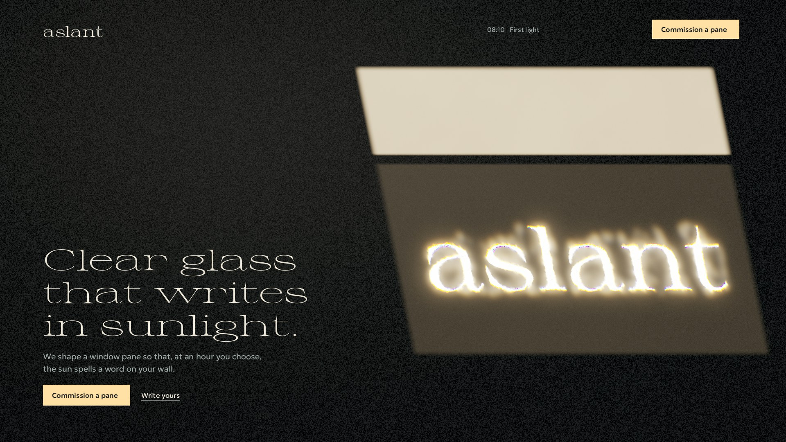
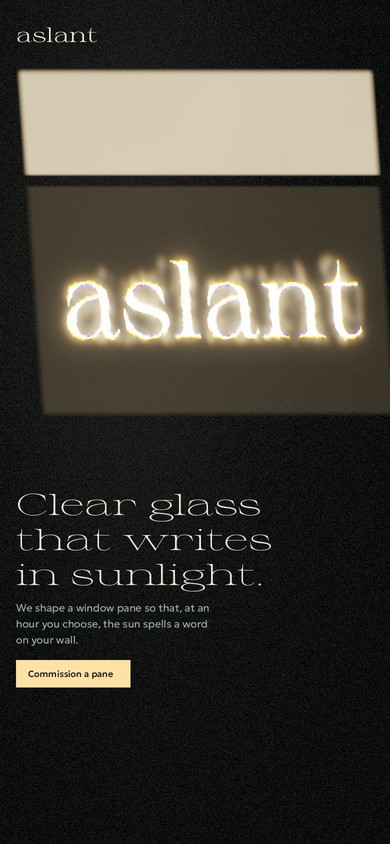
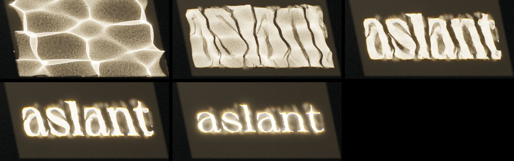
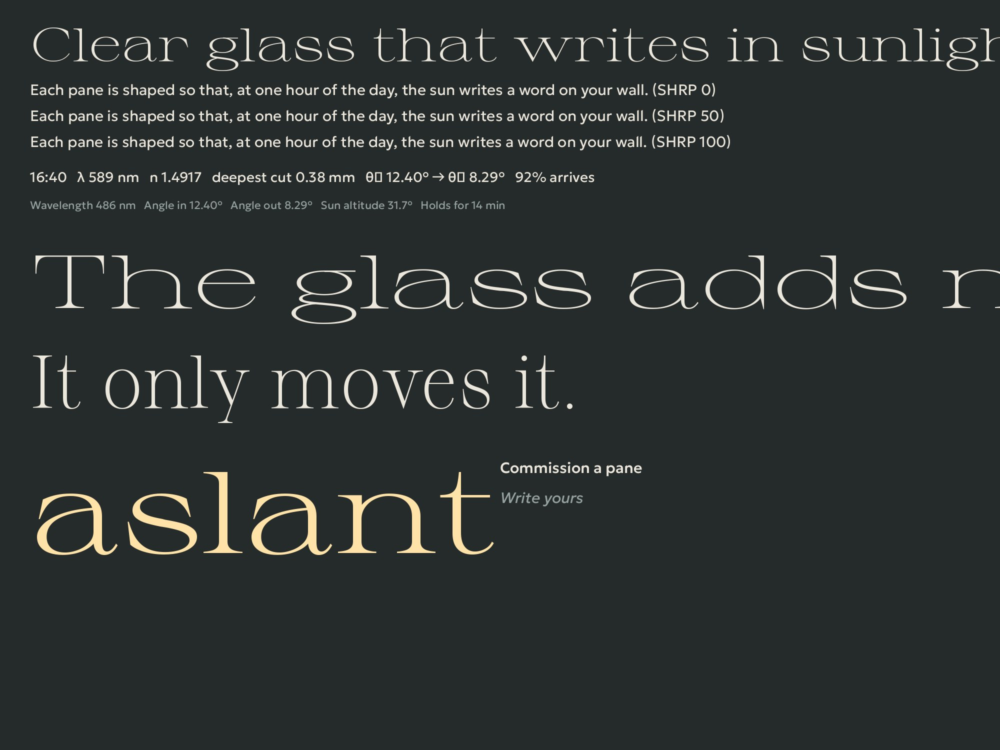

# Concept 1 · LIGHT: "aslant"

**Direction:** light and optics (refraction, dispersion, caustics, lenses, the physics of seeing)
**Author role:** creative director · **Date:** 2026-09-29 · **Status:** proposal, prototyped and verified
**Stack:** Next.js 16.3 · React 19.3 · three 0.186 · R3F 9.8 · drei 10.7 · GSAP 3.15 · Lenis 1.3 · CSS Modules + tokens

> **One sentence:** Aslant makes clear window glass that writes one word in sunlight on your wall, at the hour you choose.

| Hero, desktop (prototype render of the real pipeline) | Hero, 390 px |
|---|---|
|  |  |

Formation sequence. This is the actual output of the transport maths, not a mock:



The frames above come from a numpy prototype of the exact pipeline specified in §7 (`concept-1-light/proto/*.py`): Sprat rasterised, then sliced optimal transport, then 65,490 rays splatted at 12 to 16 wavelengths with footprint-scaled kernels, then composited as sunlight on limewash. Energy is conserved (mean irradiance 1.000 in every state). The DOM type in the hero render is set in the chosen faces. Fallback posters (text-free, calibrated to `--c-shade`) are in `concept-1-light/poster-hero-*.jpg`.

---

## 0. Why this concept (and why it is not "a prism on black")

The obvious optics site is a triangle splitting white light into a rainbow on black. That is an album cover (1973), and on the web it is a Codrops thumbnail. The less obvious truth about light is quieter and stranger: **a sheet of glass that looks perfectly clear can carry a hidden picture, and only sunlight at the right angle can read it.** People have done this with polished bronze for two thousand years, and today the surface can be computed.

Everything on the page follows from that single physical fact:

- **The WebGL is literally light.** The hero image is not an effect. It is 65,536 rays refracted by a computed surface, landing on a wall, split into wavelengths. Where rays crowd, the wall is bright. Where they part, it goes dark. Colour appears only where glass separates wavelengths.
- **The page is one room over one day.** Scroll is the sun crossing a limewashed wall from first light to dusk. The light changes angle, length and colour temperature; the typography widens as the sun gets lower.
- **The product is time.** A pane is tuned to one direction of sunlight. The word arrives, holds for about twenty minutes, and moves on. This is true (see §4, solar test vectors), and it is the emotional core: *"Every afternoon at 16:40, the kitchen wall says her name."*

**World sentence:** One dim room across one day. A window's light crosses a limewashed wall from first light to dusk, and one of its panes carries a word.
**Interaction sentence:** Scroll moves the sun through the day and the view through the room. The pointer nudges the sun, holds a loupe, or picks out a ray. The keyboard writes the word.
**Design read:** Reading this as a launch page for a made-to-order optical object, for design-literate private clients and architects. The language is calm, exact and domestic, leaning toward Nordic interior painting (Hammershøi's grey rooms, one slant of window light, dust in the beam) crossed with optical-instrument precision.
**Dials:** DESIGN_VARIANCE 8 · MOTION_INTENSITY 7 · VISUAL_DENSITY 3.

---

## 1. Brand, offer, audience, conversion

### 1.1 Name: **aslant** (slug `aslant`)
- *Aslant*, adverb: at a slant, obliquely. The pane only writes when the light comes in aslant, at its hour. Shakespeare used it ("There is a willow grows aslant a brook", *Hamlet* IV.7). The Dickinson echo is intentional: "There's a certain Slant of light, / Winter Afternoons" (first published 1890, public domain).
- Wordmark: lowercase **aslant** in Sprat, `wdth 150` `wght 70`. Rendered in sunlight it is the hero image. Rendered in `--c-lime` it is the nav logo.
- Brand mark (favicon, OG corner): a single **parallelogram of warm light** (a window's light falling aslant). It is the one simple mark we draw; no illustration.
- Ownership check (web search, 2026-09-29): "Aslant" is used by several small unrelated businesses (a Hudson Valley print shop, a Milwaukee marketing firm, a Singapore legal-recruitment firm, a UK theatre company). There is no well-known brand and nothing in glass or optics. A trademark search is needed before any real launch.
- The name avoids the slop family (Lumen, Nova, Flux, Aether). It is a real word with a physical meaning and an origin story that takes one sentence.

### 1.2 What Aslant is (fictional studio, real physics)
Aslant is a small studio (proposed home: **Copenhagen**, where the sun never climbs above 58°, so the light is always aslant; client may change it). It **computes, mills, polishes and fits caustic window panes**: sheets of clear optical acrylic ("Clear") or flint glass ("Prismatic") whose surface is shaped so that sunlight passing through writes a chosen word, name or date on a wall or floor. Each pane is tuned to an hour and a season:
- The word **holds for about 20 minutes a day** (model: the sun's direction within 2.5° of the design direction; computed below).
- Tuned near midsummer, it returns **every day for about seven weeks**. Tuned near an equinox, **for about two**.

Real-world precedent (so the product is plausible, and credited in §2 chapter 6): Han-dynasty "light-penetrating" bronze mirrors; Cassini's meridian at San Petronio (1655); Airy's 1838 paper on light near a caustic; EPFL's *High-contrast Computational Caustic Design* (SIGGRAPH 2014); hobbyist CNC "magic windows" in acrylic (Ferraro, 2021: 10 × 10 cm, n = 1.49, about 2 mm of relief). Rayform (an EPFL spin-off) sells caustic objects to brands. Nobody positions **windows tuned to the sun's hour and season**; that is our niche. Do not mention or imply any partner.

### 1.3 Audience
1. **Private clients marking a person or a date**: anniversaries, births, a name for a child's room, a memorial. Design-literate homeowners aged 30 to 65. The product is a gift with a time attached.
2. **Architects and interior designers** specifying one feature pane for a house, hotel, chapel or library.
3. (Secondary, but it matters tonight) the **design community and jury**: the site is its own proof of craft.

### 1.4 Conversion
- **Primary CTA (same label everywhere): "Commission a pane."** It scrolls to the commission form, which collects word, hour, city, window orientation, name, email and optional notes. Submit: **"Request a drawing."** The promise: "We reply within a week with a drawing of your pane and the days it will write."
- **Micro-conversion: "Write yours."** A live configurator (chapter 5). The visitor types a word, watches the glass being computed and the word forming in light, and sees true timing for their city. Its button "Commission this pane" pre-fills the form.
- **Share loop:** "Save the image" downloads a PNG of *their* word in sunlight (our own render).
- Backend tonight: `app/api/commission/route.ts` (Node runtime) validates the request (plus a honeypot field) and returns 200; storage is **a morning decision for the client** (email service or DB). If the deploy must be a static export, fall back to a `mailto:` with the fields pre-filled. The UI states stay the same either way.

### 1.5 Honesty ledger
- Fictional: the studio, its city, the first run ("forty panes, spring 2027"), lead time, sizes, the example name "Ingrid". **Flag all of these for client approval.** Prices are not stated ("We quote after we see the window").
- Real and computed live: every number the page shows about light (Snell, Fresnel, Cauchy/Abbe, solar position, legibility window, season span, relief depth, rays traced, frame time).
- Real history, verified with sources (§10).
- None: testimonials, client logos, press, awards, "trusted by", invented metrics.

---

## 2. Narrative arc: one day, nine chapters (plus act zero)

Scroll equals the page's day. Hours are authored (art direction), while every *readout* uses real astronomy. The hour of each chapter is its name in the chapter menu, which replaces section numbers.

| # | id | Hour | Beat | Layout family | View (WebGL) | Main interaction | Scroll weight |
|---|---|---|---|---|---|---|---|
| 0 | `dawn` (loader) | 05:58 | The shutters open | full-bleed, no text | wall, slit of light | none (real progress) | 0 |
| 1 | `first-light` | 08:10 | A word made of light | full-bleed canvas + asymmetric lockup | wall: two-light patch, word formed | pointer moves the sun | 1.0 |
| 2 | `clear-glass` | 10:30 | The word is in the glass | single interactive object + marginal notes | pane close-up + schlieren loupe | loupe (drag on touch) | 1.0 |
| 3 | `the-bend` | 12:50 | How it works | pinned scrub diagram + stepped captions | optical bench, side view, rays in haze | hover a ray | 2.0 (pinned) |
| 4 | `appointment` | 16:12 to 17:08 | It keeps an appointment | pinned wide scene + giant clock + data arc | wall, sun moves, word arrives and leaves | scroll is time | 1.6 (pinned) |
| 5 | `write-yours` | 17:05 | Your word | tool: controls + live light | wall, visitor's word | type, choose hour and glass | 1.2 |
| 6 | `precedent` | 18:10 | Two thousand years | typographic ledger | wall, long golden patch, loose shimmer | none (reading) | 1.0 |
| 7 | `making` | 18:50 | How it's made | spec sheet (definition grid) | wall, narrow amber sliver | none | 0.8 |
| 8 | `commission` | 19:30 | Ask for yours | form inside the last sun patch | wall, patch aligned to the DOM panel | form | 1.0 |
| 9 | `dusk` | 20:40 | Sunset, and your eye | footer composition + epilogue | patch shrinks to an ember line, then blue hour | "Watch the sunset" | 0.8 |

Tempo: spectacle, intimate, dense, cinematic, participatory, calm, calm-dense, action, silence. There are only two pins (3 and 4), each at most two screens long, and between them sits about 60vh of free scroll that carries the focus pull, so nobody is held for long. Nine content chapters use nine distinct layout families.

**One transition device everywhere: the focus pull.** At seams where the view changes (1→2, 2→3, 3→4) the frame defocuses to soft light, the view swaps at maximum blur, and it refocuses. Where the view stays on the wall (4→5→6→7→8→9), the light is continuous: the patch slides, lengthens and warms. Nothing ever cuts.

### Chapter 0: `dawn` (act-zero loader, 05:58)
- **Purpose:** real preloading (fonts, transport data, shader compile, first frame) as the first moment of the story.
- **Look:** the wall in pre-dawn shade (`#1A1F24`). A thin vertical slit of light (shutters ajar) whose brightness and width track **real progress**. Weights: fonts 0.2, light data 0.4, `compileAsync` 0.3, first frame 0.1. No numbers, no percentage.
- **Handoff:** when progress is 1 and elapsed time is at least 500 ms (failsafe 6 s), the shutters open. The slit widens into the full patch in 700 ms (`light` ease) and the hero choreography begins (§3). Repeat visits within the session get a 900 ms version. Reduced motion skips it. With no JS it never exists (SSR shows the final hero).

### Chapter 1: `first-light` (08:10), hero
See §3 for the full spec. Copy:
- **H1:** "Clear glass that writes in sunlight."
- **Sub:** "We shape a window pane so that, at an hour you choose, the sun spells a word on your wall."
- **CTAs:** "Commission a pane" (filled, sun) · "Write yours" (text link, underlined).

### Chapter 2: `clear-glass` (10:30), the loupe
- **Purpose:** establish the physics of seeing. The pane looks clear, yet the word is in its surface as curvature. Only a special way of looking (schlieren) or the sun can reveal it.
- **Layout, desktop:** focus pull into a close-up of the studio's own pane in its window: a tall rectangle occupying the right 56% (frame edges as thin shade bars). Through it we see the room behind, barely wavering (the background is displaced by the pane's slope field). Left column (x 6 to 36%): H2, body, readout legend. The **loupe** (a 220 px circle with a 1 px lit rim) follows the pointer over the pane and shows the **knife-edge schlieren** image of the relief. Readouts sit at the loupe's lower-right, live at its centre.
- **Layout, 390 px:** pane full-width in the top 55%, loupe starts centred and is draggable (`touch-action: none` on the pane only), text below.
- **Copy:**
  - H2: "The word is already in the glass."
  - Body: "Look through the pane and the room behind it barely wavers. The word is there, drawn as curvature across the whole sheet. You cannot read it in the glass. Only the light can."
  - Loupe hint: "Move the loupe over the glass." (touch: "Drag the loupe over the glass.")
  - DOM toggle (keyboard, reduced motion, touch alternative): "Show the relief" / "Hide the relief".
  - Readouts: "Surface slope 2.41°" · "Light turns 1.18°". Both are computed at the loupe centre from our model: pane 300 mm, throw 1.5 m, acrylic n = 1.4917. Prototype stats: median slope 2.4°, p95 4.3°, max 5.7°.
  - Footnote: "Schlieren: August Toepler's 1864 method, first used to find hidden streaks in optical glass."
- **What the loupe shows (verified in the prototype, `ref-schlieren.jpg`):** folded, dune-like ridges, one broad fold per letter, never readable letters. The copy says exactly this.
- **Motion:** loupe iris-opens (radius 0 → R, 300 ms, `focus`) on pointer-enter and closes on leave (180 ms, `defocus`). The knife-edge direction follows the pointer's velocity direction (damped). Moving diagonally re-lights the relief like raking light.
- **WebGL:** compositor `pane` mode. Background = the wall (plaster plus a far, soft sun patch), sampled with an offset of `slope × 0.004`. Inside the loupe: `I = 0.5 + k·(slope·knifeDir)`, high-passed (subtract a 24 px blur of the slope field), tinted warm grey, 1 px rim highlight, plus a faint green glass edge on the pane frame.

### Chapter 3: `the-bend` (12:50), pinned optical bench
- **Purpose:** how it works, shown as light. A side view of an optical bench in haze (like a laser in a smoke tank): sunlight enters from the left as parallel rays, passes through **a slice of the same pane** (the relief along one line through the word), and lands on the wall at the right. The wall carries a luminous intensity profile (a real data plot).
- **Layout, desktop:** full-bleed dark haze. The pane cross-section stands vertically at x 40% and the wall line at x 88%. Captions are stepped top-left (x 6 to 34%, y 12 to 40%), each beat replacing the last with a 240 ms crossfade (the rays carry the motion here). Readouts sit bottom-left. A small honest scale note sits under the pane: "Relief drawn 40 times deeper than it is."
- **Layout, 390 px:** the bench rotates 90°. Light falls from the top, the pane is horizontal at y 30%, the wall is at the bottom. Captions sit at the top, readouts below the wall.
- **Pin:** `end: '+=200%'`, `scrub: 1`, `anticipatePin: 1`, `invalidateOnRefresh: true`. Four beats at 0 / 25 / 50 / 75%.
- **Copy:**
  - H2 (stays): "Light bends where the glass tilts."
  - Beat 1 (flat pane): "Through flat glass, light keeps its course." Readout: "Deviation 0.00°".
  - Beat 2 (the relief morphs in): "Tilt the surface a few degrees and each ray leaves at a new angle. Where rays crowd, the wall is bright. Where they part, it goes dark." Readout (hovered or central ray): "Angle in 3.10°" · "Angle out 4.63°".
  - Beat 3 (energy): "The glass adds no light. It only moves it." Small line: "92 of every 100 photons reach the wall. The two faces reflect the rest." This is Fresnel at normal incidence for n = 1.4917: 3.89% per face, 92.4% transmitted.
  - Beat 4 (dispersion; single-wavelength light becomes sunlight): "Sunlight is every colour at once. Glass bends violet a little more than red, so each bright edge carries a thin spectrum." Readouts: "n 1.4977 at 486 nm" · "n 1.4891 at 656 nm".
  - Caption under the plot: "A slice through the pane you just looked at, along one line of the word."
- **Interaction:** the pointer picks the nearest ray (desktop). It brightens and shows its angles in and out, live Snell. On touch, tapping the bench picks a ray.
- **WebGL:** CPU ray trace (§7.6) of 64 rays × 12 wavelengths through the relief slice, drawn as instanced soft lines, additive over the haze. The wall profile is a histogram of landing positions (smoothed) drawn as a glowing polyline. Beat 4 fans every ray into a spectrum after the pane. The fans are drawn at true relative dispersion (1.74% for acrylic), with the bench geometry exaggerated and labelled.

### Chapter 4: `appointment` (16:12 to 17:08), pinned, scroll is time
- **Purpose:** the product's soul. The word exists only near its hour, and only in its season.
- **Layout, desktop:** the wall, afternoon. A **giant clock** in Sprat hairline extended (`wdth 200` `wght 14`, about 14vw) sits in the shade, upper left. It is a true readout of the scrubbed time. Under it: H2, sub, and a small **sun-path arc** (inline SVG data graphic: today's arc for Copenhagen, the sun as a dot, the "in focus" window highlighted). The patch sits centre-right and slides and skews as the minutes pass.
- **Layout, 390 px:** clock top (about 22vw), patch middle, text and arc bottom.
- **Pin:** `end: '+=160%'`, `scrub: 1`. Scroll maps linearly to 16:12 → 17:08. The example pane says **"Ingrid"** and is tuned to 16:40 on 21 June, window facing west-south-west.
- **Copy:**
  - H2: "It keeps one appointment a day."
  - Sub: "A pane is shaped for one direction of sunlight. Before its hour the light is loose. After, it moves on."
  - Second beat (at 60% of the pin): "Tuned to midsummer, the word returns every afternoon for about seven weeks. Tuned to the equinox, for about two."
  - Caption: "This pane says Ingrid. Copenhagen, a window facing west-south-west."
  - Live readouts: "Sun altitude 40.2°" · "Azimuth 251.7°" · "In focus 16:30 to 16:50".
- **WebGL:** caustic system with `uSunOffset(t)` along the true sun path relative to the design direction. Focus falls off with angular error: the word sharpens toward 16:40 and smears after it. The patch transform is keyed to t, and the sun's colour temperature warms slightly across the range.

### Chapter 5: `write-yours` (17:05), participatory climax
- **Purpose:** put the visitor's own word in the light, with true numbers for their city. This is the conversion engine.
- **Layout, desktop:** controls column left (x 6 to 38%). The wall on the right holds the patch with the live word (x 42 to 96%). Readouts sit under the patch. A tiny **relief contour map** (their pane's surface; 2D canvas, 1 px contours) sits bottom-right as an honest data graphic.
- **Layout, 390 px:** patch first (top 40%), then input, hour, glass and city stacked. On input focus, scroll so the patch and the field are both visible above the keyboard.
- **Controls (labels above, helper below, errors below):**
  - "Your word" (default "Ingrid", select-all on focus). Helper: "Up to ten letters. Names and dates work well." Errors: "Ten letters at most." / "Letters, numbers and spaces only."
  - "The hour": range 06:00 to 21:00, step 5 min, value shown in tabular figures.
  - "Glass": radio group. "Clear" (helper: "Optical acrylic. White letters, faint colour at the edges.") or "Prismatic" (helper: "Flint glass. Each letter arrives with a spectrum along its edges.").
  - "Where": city select, prefilled from the time zone. Helper: "We guessed from your time zone."
- **Copy:**
  - H2: "Choose a word and an hour."
  - Sub: "Type up to ten letters. We compute the glass while you watch, then show you what your wall will see."
  - Status while computing: "Computing the glass" plus a live count, "65,536 rays".
  - Result (aria-live polite; every value computed live): "Your word arrives at {16:40} and holds for about {20} minutes, from {28 May} to {17 July}." plus "Deepest relief {d} mm" and "Steepest slope {s}°". (The values in braces here are Copenhagen, 21 June, from the §4 test vectors. The prototype's own "aslant" pane has a steepest slope of 5.74°.)
  - Buttons: "Commission this pane" (primary; pre-fills the form, scrolls to chapter 8) · "Save the image" (secondary; downloads `aslant-<word>.png`).
- **Signature behaviour:** on input (debounced 250 ms) the current word defocuses (focus 1 → 0.15, 450 ms, `defocus`). The worker streams intermediate sliced-OT states every 8 iterations. The visitor literally **watches the optimisation converge into their word**, and the final focus eases to 1 over 1.6 s (`focus`). Changing the hour re-colours and re-angles the light and updates the readouts; the word stays formed because the pane is designed for that hour. Changing the glass re-weights dispersion live, with no recompute.
- **WebGL:** caustic system fed by worker output. The download renders the caustic plus compositor to an offscreen RT at 2048 × 1024 and encodes it with `toBlob`.

### Chapter 6: `precedent` (18:10), typographic ledger
- **Purpose:** depth, honesty, culture. A slow, readable chapter (tempo contrast).
- **Layout:** five rows. Left column: place and date in Sprat extended light (large). Right column: 25 to 35 words in Geologica. Hairline separators organise the list (a real list, so allowed). The WebGL is calm: a long, low golden patch with a *loose shimmer* in the word pane, because the hour has passed.
- **Copy:**
  - H2: "The idea is two thousand years old."
  - "Han dynasty China · 202 BCE to 220 CE": "Bronze mirrors were polished until, in sunlight, they threw the pattern cast on their backs onto a wall. They were called light-penetrating mirrors."
  - "Bologna · 1655": "Giovanni Domenico Cassini had a hole made in the roof of San Petronio, 27 metres up. At noon an image of the sun still crosses his line on the floor."
  - "Cambridge · 1838": "George Biddell Airy published On the Intensity of Light in the Neighbourhood of a Caustic: the mathematics of the bright seams where rays crowd together."
  - "Lausanne · 2014": "Researchers at EPFL published a method for computing a transparent surface whose light draws a chosen image."
  - "Copenhagen · 2027": "We tune that arithmetic to the sun over your window."
- **Motion:** each year focuses in once on entry. Nothing else moves.

### Chapter 7: `making` (18:50), spec sheet
- **Layout:** two-column definition grid (`<dl>`), terms in `--c-dust`, values in `--c-lime`, generous row gaps. The WebGL is a narrow amber sliver, low on the wall.
- **Copy (all product facts need client approval):**
  - H2: "Milled by machine, polished by hand."
  - Intro: "Each pane starts as a computed surface and ends as a sheet you can see straight through."
  - Glass: "Clear: optical acrylic, 12 mm. Prismatic: flint glass, 10 mm."
  - Size: "From 20 × 20 cm to 60 × 90 cm."
  - Distance to the wall: "The word forms 1 to 3 metres from the glass."
  - Fitting: "We fit the pane inside your window, set to the sun's direction on the day we visit."
  - Time: "About ten weeks from your word to your wall."
  - First run: "Forty panes, cut in spring 2027."
  - Price: "We quote after we see the window."

### Chapter 8: `commission` (19:30), the form in the last sun patch
- **Layout:** the one authored theme exception. The form sits on a **sunlit surface** (`--c-sunlit`, text `--c-umber`, 11.8:1) shaped as a DOM parallelogram (`clip-path` skew 8°, soft penumbra via a blurred pseudo-element). The WebGL patch aligns behind it (DOM rect measured on refresh; One Clock keeps them locked while scrolling). H2 sits in the shade to the left. On mobile the panel is full-width with a 4° skew.
- **Copy:**
  - H2: "Tell us the word and the hour."
  - Sub: "We reply within a week with a drawing of your pane and the days it will write."
  - Fields: "Your word" · "The hour" · "City" · "The window faces" (North, North-east, East, South-east, South, South-west, West, North-west, Not sure) · "Your name" · "Email" · "Anything we should know" (optional).
  - Consent: "We use your email only to reply about this pane."
  - Submit: "Request a drawing." Sending state: button label "Sending", with a thin line of light travelling along its bottom edge.
  - Errors: "We need an email to reply." · "Ten letters at most." · Network: "That did not send. Try again, or write to us directly."
  - Hint (computed; shown when North is chosen with a mid-day hour): "A north-facing window sees direct sun only early and late in summer."
  - Success: "Thank you. We will write within a week." The panel content fades and **their word forms in the last light** inside the patch.

### Chapter 9: `dusk` (20:40), footer and epilogue
- **Epilogue (optional participation):** the patch has shrunk to an ember line (`#FF9B54`) with a tiny fixation mark. A button, "Watch the sunset", holds the ember steady for 15 s with a hairline timer. Then the light switches off (one step, no flicker), the wall goes to a pale blue-hour grey (`#8A9298`) for 5 s, and this text appears: "If you watched it to the end, you may see a pale blue shape on the wall. That colour is not on your screen. Your eye made it." This is a negative afterimage: the physics of seeing, closing the page. It is safe (a single on/off change, well below the WCAG 2.3.1 threshold) and works under reduced motion.
- **Footer composition:** the large dim wordmark; one line, "Clear glass that writes in sunlight. Copenhagen."; links (separate items): "Commission a pane", "Write yours", "Colophon", "Email us" (address TBD by client); toggles: "Sound", "Motion: full / calm". A live line, "Sunset in Berlin today: 19:04.", with the city derived from `Intl` time zone via a table of about 40 cities and computed with the same solar code.
- **Colophon (dialog):** "The spectra on this page are computed, not painted: each ray is traced at 8 wavelengths between 400 and 700 nm and converted with the CIE 1931 observer. 65,536 rays per frame. Sun positions from NOAA's solar equations. Type: Sprat by Ethan Nakache and Geologica by Monokrom, both under the SIL Open Font License. Our name is the angle of the light, and a line by Emily Dickinson: There's a certain Slant of light. Built with Next.js, three.js, GSAP and Lenis. This frame took 4.1 ms." (live).
- **404:** "No light reaches this page." with a dim wall and a small loose shimmer. Link: "Back to the window."

---

## 3. HERO in detail

### 3.1 Composition (desktop 1440 × 900; ratios hold at 1920 × 1080)
```
+----------------------------------------------------------------------------------+
| aslant                                   08:10 First light (dial)  [Commission a pane] |
|                                     ______________________________                |
|                                    /  plain upper light (warm)    /               |
|                                   /______________________________/  <- transom bar |
|                                  /                               /                 |
|                                 /     a s l a n t  (in light)   /                  |
|  Clear glass                   /   (pane light dimmer: energy   /                   |
|  that writes                  /     moved into the letters)    /                    |
|  in sunlight.                /_______________________________/                      |
|  We shape a window pane so that, at an hour you choose, the sun spells a word...    |
|  [Commission a pane]  Write yours                                                   |
+----------------------------------------------------------------------------------+
```
- **Patch:** parallelogram, x 45.5% to 90.5% at the top edge, skew 0.20 × height (lower edge shifted right), y 15.5% to 80%. Upper light 30% of the height, transom bar 3.5%, lower light (the word) 66.5%. Penumbra is about 1.2% of the patch size (the sun's 0.53° disc at about 2 m throws an 18 mm soft edge).
- **Word:** fills about 72% of the lower light's width. Rays go only to the letters. The pane light keeps a 7% energy-matched fill, so the lower light is visibly *darker than the plain upper light*. That contrast is the concept in one glance: two panes, one ordinary, one ours.
- **Type lockup:** bottom-left in the shade, H1 in 3 lines (Sprat `wdth 185` `wght 26`, `clamp(2.5rem, 4.6vw, 4.75rem)`, line-height 1.02). Sub in Geologica 20 px `--c-dust`, 2 lines. CTAs 48 px tall.
- **390 × 844:** patch at x 5 to 88% (skew 0.07), y 9 to 48%, with only the lower light holding the word at about 80% of the width. Upper light as a thin band. Lockup below at y 57 to 90%. Verified in `ref-hero-mobile.jpg`.

### 3.2 Static first frame (no JS, no WebGL)
SSR HTML is complete: nav (wordmark link, static "08:10 First light", Commission link), H1, sub, both CTAs, and all nine chapters in order. The fixed stage layer shows **`poster-hero-desktop.jpg` / `poster-hero-mobile.jpg`** via `<picture>` (WebP about 180 KB; our own render, calibrated so its shade equals `#252B2C`). No JS means no loader, no hidden text (`html.js` gates every reveal) and native scroll. **The poster will probably be the LCP element** (a full-viewport ``), so keep it at or below 180 KB WebP, preload it with `fetchpriority="high"`, and make sure the H1 paints in the same frame. Target LCP ≤ 1.5 s.

### 3.3 The first three seconds (JS + WebGL ready; times from shutter-open)
| t | What happens | Channel |
|---|---|---|
| 0 ms | Shutters open: the loader slit widens into the patch, 700 ms `light`. Sky irradiance ramps from pre-dawn to morning. Dust motes appear only inside the beam. | WebGL |
| 200 ms | Lower light shows **pool-light caustics** (focus 0, wave 1), animated. | WebGL |
| 500 to 2700 ms | **Formation:** `uFocus 0 → 1` (2.2 s, `focus`), `uWave 1 → 0.04`. The light condenses into a slab, cracks open along the letter gaps and sharpens into *aslant* (see `ref-formation.jpg`). This is the true displacement interpolation of the transport map, the same states a real pane would show at intermediate wall distances. | WebGL |
| 900 ms | H1 focuses in word by word (§6.3), stagger 60 ms. | DOM |
| 1300 ms | Sub fades in, 500 ms. | DOM |
| 1500 ms | CTAs fade in, 400 ms. Nav was usable from 0 ms. | DOM |
| 2700 ms | Settled. Residual shimmer 4%; the word breathes with the air. Pointer control engages. | both |

Scrolling during the intro fast-forwards it to the settled state in 300 ms and never blocks input. Reduced motion shows the settled frame immediately (no loader, no formation).

### 3.4 Pointer response ("you are moving the sun")
- The desktop pointer offset from the viewport centre maps to a target sun error of ±0.035 pane widths horizontally and ±0.025 vertically, damped (λ = 3.2, heavy and slow). The word translates slightly and **loosens**: aberration ∝ |offset|², wave amplitude +0.25·|offset|, splat size +30%·|offset|. Moving the pointer back to the centre re-forms it.
- After 2.5 s of pointer stillness the target eases back to 0: the sun returns and the word re-forms on its own.
- Clamped so the word stays legible in the central 60% of pointer travel.
- Touch has no pointer mapping; the hero stays calm and legible. There is no gyroscope (it needs a permission prompt).
- The native cursor is always visible. No cursor companion in the hero.

### 3.5 The one image people will remember
**A slanted patch of morning sun on a grey wall, and in the lower pane of that light, a word made of the light itself, its edges faintly split into colour.**

---

## 4. Signature moments (what exists nowhere else)

1. **First light: a word condensing out of pool light.** It is real transport physics, not a particle morph: every frame is a physically valid caustic. The pointer is the sun.
2. **The loupe: seeing what clear glass does to light.** A schlieren lens over "empty" glass reveals dune-like folds, one per letter, with live slope readouts. The line the jury will quote: "You cannot read it in the glass. Only the light can."
3. **Write yours: watch your glass being computed.** Type a word. A worker runs sliced optimal transport, and you watch the optimisation converge into your word in sunlight. True numbers for your city follow: "arrives at 16:40, holds for about 20 minutes, from 28 May to 17 July." Save the image, then commission it. **(Participatory; the share loop.)**
4. **The last light: the colour your eye makes.** Watch the sunset line until it switches off, and a pale blue afterimage appears on the wall. Every colour on the page came from glass; the last one comes from you.

**Solar test vectors** (NOAA general solar position, tolerance 2.5°, Copenhagen 55.6761 N 12.5683 E):

| Design moment | Altitude | Azimuth | Daily window | Season span |
|---|---|---|---|---|
| 2026-06-21 16:40 CEST | 40.20° | 251.71° | 20 min (16:30 to 16:50) | 51 days (-24 to +26) |
| 2026-03-20 16:40 CET | 13.16° | 249.19° | 18 min | 13 days |
| 2026-09-29 16:40 CEST | 16.99° | 238.90° | 20 min | 13 days |

Copenhagen's maximum solar altitude is 57.76°. The engineers' `sun.ts` must reproduce these to ±0.1° in a unit test.

---

## 5. Typography



### 5.1 Faces (two families; no monospace)
| Role | Face | Source / license | Axes (verified with fontTools) | Why this face |
|---|---|---|---|---|
| Display, wordmark, numerals | **Sprat**, Ethan Nakache (Collletttivo), v2.000 | `github.com/EthanNakache/Sprat-type`, `Sprat_Variable.ttf` (116 KB, 230 glyphs, extended Latin), **SIL OFL 1.1** | `wdth` **100 to 200** (default 100), `wght` **10 to 200** (default 10). Non-standard ranges. | Long, sharp, cusped serifs read like the *cusps of a caustic*. The extended thin cuts look like light stretched across a wall at low sun. Rare on the web; not on any reflex list. |
| Text, UI, live data | **Geologica**, Monokrom (Sindre Bremnes, Frode Helland) | Google Fonts via `next/font/google`, **SIL OFL 1.1** | `wght` 100 to 900, `SHRP` 0 to 100, `CRSV` 0 to 1, `slnt` -12 to 0 | Calm, crisp, humanist-geometric. It has **Greek (λ, θ, Δ, µ) and every symbol we need** (→ ° × − ≈ ′ ″) plus `tnum`, so no mono is needed. Mono labels as "technical costume" are banned (#17). |

Checked and rejected (specimens rendered): Martian Mono, Fragment Mono and Datatype lack λ and θ; Host Grotesk and Funnel Sans lack Greek; Commissioner lacks → and `tnum`; Mona Sans reads as GitHub; Inter, Space Grotesk, Instrument, Fraunces, Playfair and Newsreader are on the reflex list.

### 5.2 Loading
```ts
// app/fonts.ts
import localFont from 'next/font/local'
import { Geologica } from 'next/font/google'
export const sprat = localFont({
  src: '../src/fonts/Sprat_Variable.woff2',          // TTF→WOFF2 conversion is permitted by the OFL
  variable: '--font-sprat', display: 'swap', weight: '10 200',
  declarations: [{ prop: 'font-stretch', value: '100% 200%' }],
  adjustFontFallback: 'Times New Roman',
})
export const geologica = Geologica({
  subsets: ['latin', 'latin-ext', 'greek'], axes: ['SHRP'],   // omit `weight` when passing axes
  variable: '--font-geologica', display: 'swap',
})
```
- Canvas rasterisation of words (transport input) uses a **static instance**, `Sprat-RegularMedium.otf` (≤ 7 letters) or `Sprat-CondensedMedium.otf` (8 to 10 letters). Register it with `new FontFace('SpratRaster', ...)` and `await document.fonts.load('200px SpratRaster')` before drawing, because canvas cannot set variable axes reliably across browsers. The OG image (Satori) uses `Sprat-ExtendedLight.otf`. Ship `Licence_OFL.txt` alongside.
- Sprat has **no Greek and no `tnum`**. Headlines never contain Greek. Big clock numerals are set **digit by digit in fixed-width slots** (`inline-block; width: 0.62em; text-align: center`) so they never jitter.

### 5.3 Scale and settings
| Token | Face / axes | Size | Line-height · tracking |
|---|---|---|---|
| `--t-hero` | Sprat `wdth 185` `wght 26` | `clamp(2.5rem, 4.6vw, 4.75rem)` | 1.02 · 0 |
| `--t-h2` | Sprat `wdth` by chapter hour (below), `wght 30 to 40` | `clamp(2rem, 3.6vw, 3.75rem)` | 1.04 · 0 |
| `--t-numeral` | Sprat `wdth 200` `wght 14 to 20` | `clamp(4rem, 14vw, 13rem)` | 0.9 · 0.01em |
| `--t-year` (ledger) | Sprat `wdth 190` `wght 22` | `clamp(2.25rem, 4vw, 4rem)` | 1 · 0 |
| `--t-wordmark` | Sprat `wdth 150` `wght 70` | 34 to 40 px | 1 |
| `--t-lead` | Geologica 340, SHRP 0 | 1.25rem | 1.5 |
| `--t-body` | Geologica 360, SHRP 0 | 1.0625rem (17 px) | 1.6, max 64ch |
| `--t-ui` (buttons, labels) | Geologica 520, SHRP 100 | 0.9375rem | 1.2 · 0.01em |
| `--t-readout` | Geologica 420, SHRP 100, `tnum` | 0.8125rem label / 0.9375rem value | 1.4 |

**The type follows the light.** Sprat's width axis is set per chapter from the sun's height at that chapter's hour: low sun gives long light and wide letters. H2 `wdth`: 08:10 → 190, 10:30 → 150, 12:50 → 110, 16:40 → 150, 17:05 → 160, 18:10 → 180, 18:50 → 190, 19:30 → 200, dusk → 200 (hairline). The values are **static per section** (no reflow while scrolling), explained in one colophon line. Readout labels are in words (sentence case), and the symbols (λ, n) stay secondary. Subscripts are avoided (Geologica has no `sinf`).

---

## 6. Color, texture, motion

### 6.1 Palette ("shade and sun"; WCAG ratios computed)
| Token | Hex | OKLCH | Role | Key contrasts |
|---|---|---|---|---|
| `--c-shade` | `#252B2C` | 0.284 0.009 209 | Page ground: limewashed plaster lit only by skylight. Body background, canvas clear, posters. | |
| `--c-plaster` | `#323A3B` | 0.341 0.011 206 | Raised surfaces: menu panel, inputs | |
| `--c-lime` | `#ECE6D9` | 0.926 0.019 86 | Primary text | 11.56 on shade · 9.36 on plaster · 13.59 on dusk |
| `--c-dust` | `#A2ACA8` | 0.735 0.013 170 | Secondary text, labels, input underlines | 6.16 on shade · 4.99 on plaster · 7.25 on dusk |
| `--c-sun` | `#FFE1A6` | 0.921 0.082 84 | **The one accent: direct sunlight.** Primary button fill, focus ring, `::selection`, caret. Under 3% of DOM pixels. | umber on sun 12.66 · sun on shade 11.35 |
| `--c-sunlit` | `#E9DCBF` | 0.897 0.041 87 | Wall under direct sun: the commission panel only | umber on sunlit 11.80 |
| `--c-umber` | `#1E2224` | 0.249 0.007 229 | Text on sunlit surfaces | |
| `--c-dusk` | `#181D26` | 0.230 0.019 262 | Blue hour: footer ground | |
| `--c-ember` | `#FF9B54` | 0.780 0.147 54 | Sunset light (WebGL and epilogue only) | 6.89 on shade |

- **Colour strategy: Restrained plus one physical event.** The page is grey plaster and warm light. **The only saturated colour anywhere is the spectrum, computed from wavelengths (CIE 1931) where glass separates them.** No colour tokens exist for spectra, and nothing in the UI is rainbow.
- **Why a dim ground is allowed (anti-slop #4, #10):** the scene is a room in shade with one source of sunlight. It is not "dark because tech". The ground has a hue, the shadows are skylight-cool, the light is sun-warm and has a source, and glow exists only where rays physically concentrate.
- **Light ramp (WebGL only; sun colour × intensity):** 06:00 `#FFD2A8`×0.6 · 08:10 `#FFE3C4`×1.15 · 10:30 `#FFF0DE`×1.25 · 12:50 `#FFF5EA`×1.3 · 16:40 `#FFE6BF`×1.2 · 17:05 `#FFDFB2`×1.15 · 18:10 `#FFCB8A`×1.0 · 18:50 `#FFB870`×0.9 · 19:30 `#FFA65C`×0.8 · 20:10 `#FF8A4A`×0.5.
- **Shade tint by hour** (all L ≤ 0.03, so `--c-lime` stays ≥ 11:1): dawn `#1E252C`, morning `#232A2D`, noon `#262B2C`, afternoon `#282B2A`, golden `#2A2926`, dusk `#1B202A`.
- **Calibration rule:** tone-mapped output of an unlit wall pixel at 10:30 must equal `--c-shade` within 2 sRGB levels. The prototype hit this at exposure 1.9. Shader colours come from tokens via `new THREE.Color(hex)` (sRGB → linear), with hex twins for every token a shader reads.
- **Browser surfaces:** `::selection` sun/umber; `caret-color` sun; focus ring 2 px sun with 3 px offset (umber on the sunlit panel); links underline-offset 0.22em, 1 px, dust, sun on hover; thin scrollbar (thumb `#3A4244`); `theme-color #252B2C`.
- **Radius:** 0 everywhere (cut glass). The only curve is the loupe, because lenses are round.

### 6.2 Texture and materials (all caused, none pasted)
- **Limewash plaster:** albedo 0.62 × `#D6CEBE` (linear) × two-scale fbm mottling (±7%). The wall is pale; it only *reads* dark because it is in shade. **Radiance = albedo × (skylight + sunlight·mask·caustic)**. Multiplicative lighting is what makes the patch read as light on a surface; the first prototype added light on top of the wall and looked like beige paper.
- **Grain = photon noise:** per-frame hash noise with amplitude ∝ 1/√(luminance). Stronger in shade, nearly gone in the sun. It lives in the compositor. No DOM grain layer (the no-WebGL poster has it baked in).
- **Penumbra:** patch edges soften by about 1.2% (the sun's disc). The plain upper light carries a ±6% "old window glass" ripple: ordinary glass also makes faint caustics, while ours makes a word.
- **Dust motes (Tyndall):** 1,200 points, visible **only inside the beam**. They drift on analytic curl noise, sink slowly, and swirl with scroll velocity.
- **Haze:** faint scattering along the beam in wall views, and dense smoke-tank haze only in the bench view.
- **Glass itself is never shown as a glossy object** (anti-slop #40). It is seen only through its effects: the wall wavering behind it, a 1 px rim highlight, and a faint green edge.

### 6.3 Motion language: "Nothing slides. Things come into focus."
- **Easing (CSS + GSAP CustomEase):**
  - `focus` = `cubic-bezier(0.16, 1, 0.3, 1)`: arrivals, word formation, heading focus-in.
  - `defocus` = `cubic-bezier(0.7, 0, 0.84, 0)`: exits, always faster than arrivals.
  - `light` = `cubic-bezier(0.45, 0, 0.2, 1)`: world changes (shutters, patch travel, day colour).
  - Scrubbed timelines use `ease: 'none'`. Bounce, elastic and back are banned.
  ```ts
  CustomEase.create('focus', 'M0,0 C0.16,1 0.3,1 1,1')
  CustomEase.create('defocus', 'M0,0 C0.7,0 0.84,0 1,1')
  CustomEase.create('light', 'M0,0 C0.45,0 0.2,1 1,1')
  ```
- **Durations:** `--dur-tick` 120 ms (hover or press) · `--dur-state` 240 ms (toggles) · `--dur-focus` 900 ms (heading focus-in) · `--dur-shutter` 700 ms · `--dur-refocus` 1600 ms (word after input) · `--dur-form` 2200 ms (hero formation). Loader under 1.5 s on a warm cache, 6 s failsafe.
- **Heading focus-in (the only split-text effect, used four times):** hero H1, `clear-glass` H2, `appointment` H2 (after the clock) and the `precedent` years. SplitText `type: 'words'`, `aria: 'auto'`, `autoSplit: true`. Words go from `{ opacity: 0, filter: 'blur(12px)', scale: 1.035 }` to rest over 0.9 s with stagger 0.06 and the `focus` ease, triggered once at `top 80%`. The slight scale is **focus breathing** (real lenses change magnification as they focus). Every other chapter's focal moment is the light itself (bench beats, the visitor's word, the patch behind the form), and their headings simply fade (400 ms). Body copy only fades (500 ms); it never translates. Readouts update as plain numbers with tabular figures and no scramble.
- **Scroll feel:** Lenis (existing provider) `lerp 0.085`, `wheelMultiplier 0.95`, anchors on. There are two pins and no snapping. Scroll drives the page hour; the conductor keeps an exact value (for UI and ARIA) and a damped value (λ 5.2) for the light.
- **Velocity means air.** Smoothed |scroll velocity| (attack 0.05 s, release 0.6 s) raises caustic shimmer (`uWave` +0.3 max), dust swirl, and a touch of defocus above a threshold. Moving air bends light (it is schlieren physics again). Skew and translate effects on DOM: none.
- **Chapter transitions:** the focus pull (§2). `uDefocus` is scrubbed over the last 20% of the outgoing chapter and the first 20% of the incoming one, and the view switches at the peak. The DOM does not blur during pulls; only the canvas does.
- **Hover and press:** primary button lightens to `#FFE9BD` and gains a 1 px inner highlight, like light catching an edge (120 ms). Press: `translateY(1px)`. Links: the underline turns sun. No magnetic buttons, no hover lifts, no infinite loops on UI.
- **Cursor decision:** native cursor always. One functional companion, **the loupe** in chapter 2 only (it is a lens and the concept needs it): `pointer-events: none`, hidden on coarse pointers (drag instead), replaced by a "Show the relief" toggle under reduced motion.
- **Reduced motion (designed, not "off"):** no Lenis, no pins, no scrub, no loader, no formation, no pointer sun, no dust drift, no shimmer. Each chapter renders its composed final frame on demand. Pinned chapters become stacked static beats (bench at beat 4; appointment at 16:40 with the word formed). The configurator still works (instant word). The epilogue still works. An in-page "Motion: full / calm" toggle writes `data-motion` and persists (try/catch storage).
- **Sound (opt-in, last in the cut order):** a `button role="switch"` labelled "Sound" with 7 tiny bars (flat when off, live band energies when on). Web Audio, created on the first click, master at or below -18 dBFS, suspended when the tab is hidden.
  - **Room:** pink-ish noise → lowpass 900 Hz, gain 0.02. Scroll velocity opens it to 1.8 kHz and 0.05 ("the air moves").
  - **Spectrum chord:** seven sine voices in **D Dorian**, the scale Newton matched to his seven colours in *Opticks* (1704): D E F G A B C spread over three octaves, red to violet. Each voice's gain follows its band's energy × focus. Loose light detunes ±12 cents with a slow tremolo; a formed word is a still, consonant chord.

---

## 7. WebGL plan

### 7.1 Architecture: one canvas, one clock
- Keep the existing scaffold: `src/lib/frame.ts`, `src/lib/store.ts`, `SmoothScroll`, `StageRoot` (poster plus lazy canvas).
- **Change `Stage.tsx` to `frameloop="never"`** and call `advance(time)` (seconds) from the GSAP ticker **after** Lenis and `readScroll()`. This is the One Clock (dossier 04, Part 2). The WebGL patch behind the DOM commission panel must not swim by a frame. Keep the visibility and context-loss lifecycle; `advance` is skipped when hidden or offscreen.
- Everything is **2D screen-space**: full-screen passes plus point splats with our own ortho camera. There is no 3D room, no GLB, and no textures to download except the tiny transport binaries. There is no `@react-three/postprocessing` (the compositor does tone mapping, halation and grain in one pass), which saves bundle weight and a full-screen pass.
- Continuous values never touch React state. The conductor writes a `light` object read in `useFrame`, and DOM readouts are written through refs.

### 7.2 Render graph per frame
1. **Caustic pass** (only when a word pane is visible): `THREE.Points` sharing one `BufferGeometry` (attributes `aOrigin` vec2, `aTarget` vec2, `aTargetPrev` vec2, `aDensity` float). It is drawn **K times, once per wavelength band** (K = 8 on tier 3), each with its own `ShaderMaterial` instance (same program) holding `uDispersion` and `uBandRGB`. Target: `rtCaustic` at 1024 × 512, `HalfFloatType`, blending `ONE, ONE`, no depth. It is cleared each frame. Output is relative irradiance, where 1.0 means plain sunlight.
2. **Bench pass** (chapter 3 only): instanced soft line quads into the default framebuffer region, or into `rtBench` at half resolution.
3. **Compositor** (always): one full-screen triangle, mode `wall | pane | bench`, crossfading at focus-pull peaks. It handles plaster albedo, skylight tint, sun patch (parallelogram SDF with penumbra, mullion and transom SDF bars), upper-light ripple, lower-light caustic (`fill 0.07 + 0.93·rtCaustic`), beam haze, halation (2 taps from a quarter-resolution bright buffer), vignette (subtle), photon grain, ACES tone mapping and sRGB out.
4. **Dust:** 1,200 points (tier 3), analytic drift in the vertex shader, masked by the beam.

### 7.3 Caustic vertex math (what the prototype validated)
```glsl
// per band: uDispersion = (n(λ)-1)/(n_d-1)   (Cauchy fit from n_d and Abbe V_d, see glass.ts)
attribute vec2 aOrigin, aTarget; attribute float aDensity;
uniform float uFocus, uWave, uTime, uDispersion, uSpacing, uPointMax, uAberr;
uniform vec2 uSunOffset;
varying float vSigma;
// 7 directional sinusoids (5 at 2.2-4.2 cycles/pane, 2 at 6-8), amplitude a_i/f_i^2:
// analytic gradient g and Hessian (hxx, hyy, hxy). Constants: see proto/v2.py WAVES.
void waves(vec2 p, float t, out vec2 g, out vec3 h);
vec2 aberrField(vec2 p);   // fixed, static, low-frequency vector field (3 sinusoids) used only for sun error
void main(){
  vec2 g; vec3 h; waves(aOrigin, uTime, g, h);
  float D = uWave * 0.018;
  vec2 disp = uFocus * (aTarget - aOrigin) + (1.0 - uFocus) * D * g;      // displacement interpolation
  vec2 p = aOrigin + uDispersion * disp + uSunOffset + uAberr * aberrField(aOrigin); // sun error: shift + |err|^2 aberration
  float detJ = abs((1.0 + D*h.x)*(1.0 + D*h.y) - D*h.z*D*h.z);              // ray differential of the wave map
  float foot = ((1.0 - uFocus) + uFocus / max(aDensity, 1e-3)) * max(detJ, 0.02);
  vSigma = clamp(0.55 * uSpacing * sqrt(foot), 0.45, 14.0);                // px; crowded rays = small, bright
  gl_PointSize = min(6.0 * vSigma, uPointMax);
  gl_Position = vec4(p * 2.0 - 1.0, 0.0, 1.0);
}
// frag: w = exp(-0.5*r²/σ²) / (2πσ²); out = uBandRGB * w * (W*H/N). Additive.
```
- **Footprint-scaled splats are non-negotiable.** With fixed splats, sparse regions turned to TV static (prototype v1). With ray-differential sizing, the pool network shows thin cusped filaments and smooth cells (v2).
- **Bands:** K wavelengths spread over 400 to 700 nm. Colours come from the Wyman, Sloan and Shirley (2013) multi-lobe CIE 1931 fit, then XYZ → linear sRGB, then **white-balanced so the bands sum to (1,1,1)**. Negative lobes are allowed in half-float and clamped in the compositor.
- **Glass (n_d, V_d):** Clear, PMMA 1.4917 / 57.4 (Cauchy A 1.47871, B 0.004484 µm²). Prismatic, flint N-SF10-like 1.72825 / 28.53 (A 1.68955, B 0.013362 µm²). The edge spectrum is 1.74% vs 3.51% of each ray's displacement. Hero and default use Clear.

### 7.4 Light transport (word to rays), `src/lib/caustics/`
1. **Raster (main thread, ~1 ms):** draw the word with `SpratRaster` into a 1024 × 480 canvas (aspect matches the lower light), fit 86% of the width, blur 0.8 px, floor 0 (rays go only to letters). Post `ImageData` to the worker.
2. **Target samples (worker):** a Hilbert-quantile stratified sample of the density: sort pixels on a 2^10 Hilbert curve, build the CDF, take N quantiles, jitter within the pixel. This takes about 100 ms in numpy and is fast in JS.
3. **Sliced optimal transport (worker):** source = **R2 low-discrepancy sequence** (Roberts' quasirandom, fixed offset) mapped to the pane's aspect, **N = 65,536** on tier 3 and 32,768 on tier 2. It is better stratified than a jittered grid, and every on-page ray count (status line, colophon) reads N from the running code, so it is always true. The prototype used a 370 × 177 jittered grid (65,490). For each iteration, pick a random direction, project both sets, sort both (**LSD radix sort on float→uint keys with an index payload**, not `Array.sort`), and move each ray by the rank-matched difference. Use **256 iterations for baked words** (the brand word, "Ingrid", "404") and **96 for live words**, posting intermediate targets every 8 iterations so the visitor watches it converge. Expect about 0.5 to 0.9 s for 96 iterations in a worker; tier 2 uses 32k rays. Do **not** use the Hilbert assignment as the final map: it moves light in rectangular blocks mid-transition (prototype `forming` state), whereas sliced OT is smooth and monotone (`ref-formation.jpg`).
4. **Footprint:** `aDensity` = normalised density at each ray's final target.
5. **Relief (worker, for readouts and the loupe):** slope field = displacement / (throw·(n-1)), with pane 300 mm, throw 1.5 m and n 1.4917. The **loupe renders the slope field directly** (thin-lens: slope ∝ displacement), so it needs no Poisson solve. Depth readouts come from a least-squares Poisson integration on 128 × 64 using **conjugate gradient** (≤ 200 iterations, about 15 ms). Plain Jacobi converges too slowly on the low frequencies: a prototype run left a large residual. Sliced OT maps carry a little curl, so the relief is their curl-free part. Show the depth as "about" with one decimal.
6. **Bake script:** `scripts/bake-light.ts` (tsx) writes `public/light/{aslant,ingrid,404}.bin`: targets as `Uint16` pairs plus density as `Uint8` (5 bytes per ray, about 330 KB each, gzip-friendly). Origins regenerate from the R2 sequence.

### 7.5 Compositor modes
- **wall:** as §7.2. Per-chapter patch rectangles, skews and light colours come from `worldSpec` (below). The commission patch comes from the measured DOM panel rect.
- **pane (chapter 2):** window frame bars, background displaced by `slope·0.004`, and the loupe disc showing the high-passed knife-edge schlieren (§2 chapter 2) with a rim and a green frame edge.
- **bench (chapter 3):** haze (low-frequency noise) plus the line layer, the glass cross-section as two edge highlights, and the wall line with the luminous profile.

### 7.6 Bench ray tracer (CPU, `bench/trace.ts`)
Rays travel horizontally and enter the flat face at normal incidence (no bend). The exit face profile is `z(y)`, a slice of the relief exaggerated 40× and labelled. At the exit, α = atan(dz/dy), θt = asin(n(λ)·sin α), and the deviation is δ = θt - α. The ray then lands on the wall at `y + L·tan δ`. With 64 rays × 12 bands there are 3 segments each, recomputed only when inputs change, at about 0.2 ms. Wall profile = histogram of landing positions (256 bins, 3-bin smooth). Hover picks the nearest ray and emits its θin, θout and n for the readout.

### 7.7 Uniform sources
| Source | Uniforms |
|---|---|
| Scroll (conductor, damped λ 5.2) | `uHour`, `uView`, `uDefocus`, `uFocus` (chapter targets), patch rect and skew, `uSunTemp`, `uSkyTint`, `uSunOffset(t)` (appointment), `uWordMix` |
| Pointer (damped λ 3.2) | `uSunOffset` (hero, write-yours), `uLoupe` (xy, radius, knife direction), bench hover index |
| Velocity (attack 0.05 s / release 0.6 s) | `uAir` (wave, dust swirl, defocus) |
| Time | `uTime` (waves, dust). Frozen under reduced motion. |
| Workers | `aTarget`/`aTargetPrev` buffers (`needsUpdate`, ranged), slope texture (RG16F, 256 × 128, rays binned by origin cell) |

**worldSpec (desktop; mobile overrides everywhere):** first-light patch x 0.455 to 0.905, y 0.155 to 0.80, skew 0.20, split 0.30 · appointment x 0.40 to 0.88, y 0.20 to 0.84, skew 0.34, drifting +0.08 across the pin · write-yours x 0.44 to 0.94, y 0.18 to 0.82, skew 0.30 · precedent x 0.52 to 0.98, y 0.36 to 0.92, skew 0.55, word loose · making x 0.60 to 1.02, y 0.52 to 0.96, skew 0.75 · commission = DOM rect, skew 0.14 · dusk collapses to a 0.6% ember line, then off. All values are art-directed starting points; tune on screen.

### 7.8 Tiers and budgets (Apple Silicon target, measured before trusting)
| Tier | Who | Rays × bands | RT | DPR | Extras | GPU target |
|---|---|---|---|---|---|---|
| 3 | fine pointer, ≥ 8 cores / Apple Silicon | 65,536 × 8 | 1024×512 half-float | ≤ 1.75 | dust 1,200, haze, halation | ≤ 6 ms |
| 2 | coarse pointer, ≤ 4 cores, `PerformanceMonitor` decline | 32,768 × 4 | 768×384 | ≤ 1.35 | dust 400, no haze or halation | ≤ 8 ms |
| 1 | reduced motion | tier-3 quality, frames on demand only | | | static | n/a |
| 0 | no WebGL2, context lost, error, Save-Data | posters + CSS light | | | | 0 |

- Estimated breakdown at tier 3: caustic pass ≤ 1.5 ms (524k small splats), compositor ≤ 2.5 ms, dust ≤ 0.2 ms, bench ≤ 0.3 ms. JS per frame ≤ 2 ms; transport runs off-thread.
- Half-float render target needs `EXT_color_buffer_float`. Fallback: RGBA8 with gain × 0.25 and the halation disabled.
- Clamp `gl_PointSize` to the device max (often 64). Skip the caustic pass when no word pane is on screen. Warm programs with `compileAsync` during the loader. Keep FBO sizes independent of DPR.
- Bundle: three + R3F + one drei import (`PerformanceMonitor`) + GSAP (ScrollTrigger, SplitText, CustomEase) + Lenis. Target ≤ 350 KB gzipped JS. LCP ≤ 1.5 s (poster image or SSR H1, whichever the browser picks), CLS ≈ 0.

### 7.9 Fallbacks and failure
- **No WebGL / context lost:** `StageRoot` poster (the hero render). Each chapter ships a **CSS light**: a parallelogram `div` with a warm gradient and blurred edges on `--c-shade`, shown only when `[data-webgl=disabled|failed]`. The hero word appears as DOM Sprat in `--c-sun` inside it. Chapter 2 and 3 use stills captured from our own renderer (`/public/light/relief-still.webp`, `bench-still.webp`). The configurator falls back to readouts only, with a note: "The live preview needs WebGL. Your numbers are still exact."
- **Context restore:** remount the scene (epoch key), re-upload the cached transport arrays, and fade the poster out after the first frame.
- **No JS:** full content, native scroll, posters, no loader, form works as plain POST (or `mailto`).

---

## 8. Feasibility: build plan for about 4 hours of parallel work

| WP | Owner | Scope | Est. | Depends |
|---|---|---|---|---|
| **WP1 Foundation** | eng A | tokens.css, fonts (§5.2), layout and nav (wordmark, day dial, menu, sound switch stub), all 9 sections as semantic SSR with final copy, `worldSpec` and conductor skeleton, One-Clock change in `Stage.tsx` | 50 min | none |
| **WP2 Light core (critical path)** | eng B (strongest GL) | raster, worker (Hilbert samples, sliced OT with radix sort, footprint), bake script, caustic points shader + bands, compositor `wall` (plaster, patch, mullions, fill, grain, tone map), hero formation, pointer sun | 100 min | fonts from WP1 |
| **WP3 Motion + chapters** | eng C | focus-in headings, pins for chapters 3 and 4 with beats and readout wiring, velocity air, reduced-motion variants, mobile compositions | 90 min | WP1 |
| **WP4 Bench + loupe** | eng D | `trace.ts`, bench line layer, compositor `pane` mode with schlieren loupe + DOM toggle, readouts | 75 min | WP2 relief data |
| **WP5 Write yours + commission** | eng E | configurator UI, streaming worker → uniforms, `sun.ts` (NOAA + test vectors) and cities table, readouts, save image, form + route handler + states, prefill | 80 min | WP2 worker API |
| **WP6 Edges** | eng F | loader with real progress, dusk epilogue, colophon, 404, favicon (SVG parallelogram), OG image (captured render), posters, console line, sound (last) | 60 min | WP2 |
| **QA** | reviewer | gates below, both browsers, 390/768/1440, reduced motion, no WebGL, keyboard, contrast, copy greps | 60 min | all |

**Critical-path gate (T+60 min):** a screenshot of *aslant* forming and settled in the live renderer that matches `ref-hero-desktop.jpg` in character (filaments in the loose state, crisp letters, a darker word pane than the plain pane). If this fails, stop and fix before any other WebGL work.

**Main risks and de-risking**
1. **The word reads as glowing text, not light.** Already de-risked by the prototype. Keep: footprint splats, 7% energy fill (the word pane darker than the plain pane), multiplicative lighting on textured plaster, photon grain, halation only above 0.9. Compare side by side with the reference.
2. **Transport quality or speed in JS.** The brand, example and 404 words are **baked**, so only visitor words compute live. Use a radix sort and stream intermediate results. If still slow, use 32k rays for live words. Last resort: Hilbert targets with a quick 3-step Laplacian smoothing (worse transitions, crisp end state).
3. **Safari:** half-float blending, point size limits and canvas fonts. Test on Safari in the first hour of WP2. Fallbacks are defined (RGBA8, point clamp, static OTF raster face).
4. **Pins + Lenis + canvas sync.** The One Clock change is in WP1. Test reverse scroll and anchor jumps into pinned chapters. `invalidateOnRefresh` everywhere measured.
5. **Scope.** Cut in this order if behind: sound → epilogue → bench hover readouts → save image → season readouts → dust → loupe (replace with the "Show the relief" still). **Never cut:** hero formation, write yours, the form, reduced-motion and no-WebGL designs.
6. **Name.** Only small unrelated businesses use it. Flag the trademark search to the client.
7. **Facts.** All history and physics verified (§10). The product specs are fictional and flagged.

**Acceptance gates (pass or fail, with evidence):** hero settled frame ≥ 55 fps on M-series Chrome and Safari · formation plays once, skippable by scrolling · reverse scroll recreates every chapter state · no horizontal overflow at 390 · reduced-motion walk-through complete with all content · WebGL-off walk-through complete · keyboard reaches loupe toggle, configurator, form, menu, sound, epilogue · all text pairs ≥ 4.5:1 (computed table above) · `grep` finds no em or en dashes and no banned words in rendered copy · `sun.ts` matches the test vectors to ±0.1° · console clean · `next build` and typecheck pass.

---

## 9. Anti-slop audit
- **Avoided outright:** prism-and-rainbow cover image; iridescent or glass blob hero; purple or blue gradients; gradient text; glassmorphism; bento; three cards; stat banner; logo wall; testimonials; eyebrows; section numbers (hours carry real narrative information and live only in the menu); scroll cue; SplitText on every heading (the focus-in is used on four focal headings only); custom cursor replacing the native one; percentage preloader; neon glows; Inter and reflex fonts; mono costume labels; em dashes; banned vocabulary ("magic" is avoided even for the Han mirrors, which are called by their translated name).
- **Conditional un-bans with written rationale:**
  - Dim ground (#4, #10): the scene is a room in shade lit by one sun; the dark has a hue and the light has a source.
  - Blur on headings: "focus" is the concept's physics; used on headings of 8 words or fewer, 12 px maximum, never on body.
  - Cursor companion: the loupe is an optical instrument, chapter 2 only, additive.
  - Oversized numerals: the clock is a true readout of the scrubbed time; the years are real dates.
  - Hairlines in the ledger: they organise a real list.
- **Distinctiveness self-score (to be re-scored blind in QA):** 9. The screenshot is identifiable without a logo, and the participatory transport moment is new on the web.

---

## 10. Sources (verified 2026-09-29)
- Sprat: `github.com/EthanNakache/Sprat-type` (OFL; README: "3 styles and 6 weights, 230 glyphs, extended Latin"); `collletttivo.it/typefaces/sprat`; axes read from the file with fontTools.
- Geologica: `github.com/google/fonts/ofl/geologica/METADATA.pb` (designer Monokrom, Sindre Bremnes, Frode Helland; OFL); axes, glyphs and features read with fontTools; subsets from Next 16.3 `font-data.json`.
- Caustic windows: Ferraro, "Hiding Images in Plain Sight: The Physics of Magic Windows", mattferraro.dev (acrylic, 10 × 10 cm, n = 1.49, about 2 mm relief). Schwartzburg, Testuz, Tagliasacchi, Pauly, "High-contrast Computational Caustic Design", ACM TOG / SIGGRAPH 2014. EPFL news "Objects that sculpt light"; Rayform (market context only).
- Han "light-penetrating" mirrors, 202 BCE to 220 CE: Wikipedia "Chinese magic mirror"; Artnet News (Cincinnati Art Museum, 2022).
- Cassini's meridian, San Petronio, 1655, light hole 27 m up, still in use: basilicadisanpetronio.org; Atlas Obscura; INAF Bologna archive.
- Airy, "On the Intensity of Light in the Neighbourhood of a Caustic", Trans. Camb. Phil. Soc. 6 (1838) 379-402: NASA ADS 1838TCaPS...6..379A.
- Newton: seven colours matched to the Dorian scale (*Opticks*, 1704): Whipple Library (Cambridge) "Universal Harmony"; huevaluechroma.com.
- Dickinson, "There's a certain Slant of light", first published 1890 (Poems, First Series): Wikipedia; Poetry Foundation.
- Toepler, schlieren method, 1864, developed to detect striae in optical glass: Wikipedia "Schlieren photography"; Springer *Shock Waves*, "August Toepler: the first who visualized shock waves".
- Solar position: NOAA general solar position equations (fractional-year method); test vectors computed in §4.
- Colour-matching fit: Wyman, Sloan, Shirley, "Simple Analytic Approximations to the CIE XYZ Color Matching Functions", JCGT 2(2), 2013.

## Appendix A: prototype notes (`concept-1-light/proto/`)
- `caustic_proto.py`: raster, Hilbert index, CIE bands, Cauchy, bilinear splat, blur.
- `v2.py`: stratified jitter, wave field with analytic gradient and Hessian, footprint-scaled splats. This version fixed the speckle of v1.
- `v3.py`: sliced OT (128 iterations, 0.9 s in numpy for 65k rays), which fixed the block artifacts of the Hilbert map.
- `composite2.py`: albedo × irradiance lighting, two-light patch, energy fill, halation, photon grain, ACES.
- Lessons, in order of importance: (1) multiplicative lighting on textured plaster; (2) footprint-scaled splats; (3) smooth transport for transitions; (4) send rays only to letters and add an energy-matched fill; (5) calibrate the shade to the DOM token.

## Appendix B: copy deck check
All visible copy in §2 and §3 respects: hero headline ≤ 7 words (6), sub ≤ 20 words (20), other headlines ≤ 8 words, paragraphs ≤ 45 words, CTA labels ≤ 3 words and identical per intent ("Commission a pane"; the one deliberate exception is the contextual "Commission this pane" in chapter 5, which carries the configured word), no em or en dashes, no rhetorical-question headings, no negative parallelism, no banned vocabulary, sentence case throughout, and middle dots only as single separators in data captions.
