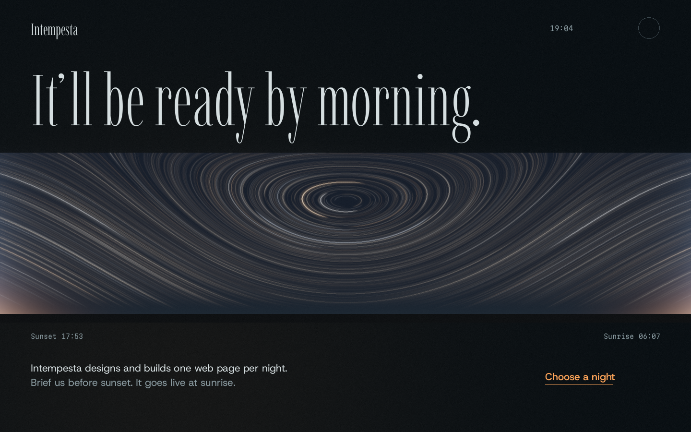
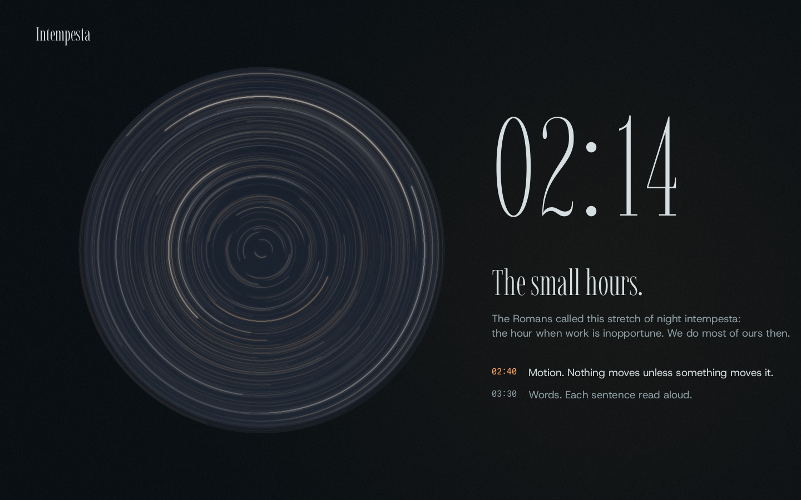

# Concept 6 · INTEMPESTA (direction: "The Night Itself")

> Role: creative director. Written 2026-09-29, in the small hours, after reading dossiers 01 to 06 in full.
> Proof of look (procedural renders using the same math the shader will use, plus real font renders):
> `concept-6-night/hero-mock.png` · `concept-6-night/small-hours-mock.png` · `concept-6-night/type-specimen-night.png` · `concept-6-night/type-specimen-day.png` · reference math `concept-6-night/trails-reference.py`.
> Everything numeric below (sun events, moon, night lengths, font axes, credits) was computed or read from source files, not recalled.

---

## 0. The idea, four ways

- **One sentence, said out loud:** an overnight studio whose landing page is the night it was made: one long exposure seen through windows in a dark wall, from sunset until the sunrise turns the page to day.
- **World sentence:** a dark studio wall with openings cut into it. Behind the wall, one sky turns through one real night (28 to 29 September 2026, latitude 52° N). Scrolling is the clock, and at sunrise the wall opens and the page steps out into daylight.
- **Interaction sentence:** scroll moves the clock and the wall. The pointer is the studio lamp on the plaster, and your head moving in front of the windows. Holding the shutter (B) exposes a night of your own, and lets you draw into it with light.
- **Why it can win:** it turns the true fact (made overnight, while the client slept, to be opened in the morning) into a universal offer and a physical medium, so the brand's only proof is the page itself. Nobody has shipped a live long exposure as a website. All the WebGL is **one full-screen fragment pass** (cheap, deterministic, reversible). The metaphor reaches the loader, nav, 404, favicon, browser chrome and colophon.




---

## 1. Brand and offer

### 1.1 Name: **Intempesta** · slug `intempesta` · say it in-tem-PES-ta
- **Source.** Censorinus, *De Die Natali* (238 AD), ch. 24, lists the Roman parts of the night: vespera, crepusculum, *luminibus accensis* (lamps lit), concubium (bedtime), then "the *intempesta* (inopportune time to act), that is to say quite night, when work is intempesta, or inopportune" (W. Maude translation, verified on elfinspell.com). Italian still says *a notte intempesta* for "at dead of night".
- **The brand's joke is its promise:** the Romans named the hour when work makes no sense, and this studio works then.
- **Collision check (web search, 2026-09-29):** no studio or brand named Intempesta found. My first choice, "Small Hours", is **rejected**: a working brand-design studio (smallhoursstudio.com) and a homewares brand with a clock-colon logomark already use it. "Greyline" is rejected too (an existing web-development studio).
- It avoids every startup-slop pattern (no -ly/-ify, no Nova/Lumen/Nexus). It is a real word with a real, specific source, and it sets beautifully in a condensed Didone (see specimen).

### 1.2 Offer
**Intempesta designs and builds one web page per night. Brief it before sunset; the page is live at sunrise.** That covers launch pages, event pages, product pages and portfolios: one page, one night.

### 1.3 Audience
Founders, product and marketing leads, artists and organizers who need one page made properly by tomorrow morning: people who care about craft and also have a 09:00 deadline.

### 1.4 Conversion
- **Primary: "Choose a night".** The visitor picks a night on a live almanac (each night shows its true moon phase and length). Then comes a three-field brief plus email, and the button **"Request this night"**.
  - The endpoint is configurable (`NEXT_PUBLIC_FORM_ENDPOINT`, e.g. Formspree). Without it, the form composes a `mailto:` to `NEXT_PUBLIC_CONTACT_EMAIL`. With neither set, the submit button explains that requests are not open yet.
  - The page never fakes a confirmation.
- **Secondary (shareable): "Keep this exposure".** The visitor downloads the long exposure they made in the Bulb chapter (PNG with a caption bar), which carries the brand wherever it is shared.

### 1.5 Voice
- The studio talks quietly at night: short declaratives, concrete nouns, physical verbs and exact times.
- At most one dry joke per chapter.
- American spelling. **No em or en dashes in shipped copy.** The minus sign (−) is used only in live data readouts.
- It never claims clients, awards, team size or metrics. The proof is the page and its own true making log (colophon).

---

## 2. Core metaphor and narrative arc

### 2.1 The model night (true, computed; `astro.ts` must reproduce these numbers)
Latitude 52° N, local apparent solar time, night of 28 to 29 September 2026. The solar declination runs from −2.23° to −2.43° over the night.

| Event | Time | Sun altitude |
|---|---|---|
| Sunset | 17:54 | −0.83° |
| Civil dusk | 18:28 | −6° |
| Nautical dusk | 19:07 | −12° |
| Astronomical dusk ("nightfall") | 19:48 | −18° |
| Solar midnight | 00:00 | −40.4° |
| Astronomical dawn | 04:14 | −18° |
| Nautical dawn | 04:54 | −12° |
| Civil dawn | 05:33 | −6° |
| Sunrise | 06:07 | −0.83° |

- **Moon that night:** waning gibbous, 94% lit (full on 26 Sep). It is **left out of the sky on purpose**, and the colophon says so.
- **Stars:** they rotate about the celestial pole (altitude 52°, due north) at the sidereal rate of 15.041°/h.
- **Night lengths at 52° N** (shown by the almanac): 29 Sep 12 h 17 min · 14 Oct 13 h 16 min · 1 Nov 14 h 25 min · 21 Dec 16 h 16 min · 21 Jun 7 h 16 min.

### 2.2 The metaphor, in five rules
1. **The page is a wall** (the studio at night). The canvas paints the wall and cuts **windows** into it. Behind the wall there is **one sky** and one clock.
2. **Every window is a camera with its shutter open.** Stars leave trails, and a trail's length is elapsed time. Windows face different directions of the same sky, so the trails change shape truthfully:
   - concentric circles toward the pole;
   - sweeping arcs in the panorama;
   - gentle rising arcs to the south-east;
   - lines fading into the sunrise in the east.
3. **Scroll is the clock.** The top of the page is nightfall and the bottom is morning. The same scroll position always recreates the same state, forward, backward, after a jump or after a reload.
4. **Color is physiology.** At night the room is seen with rods (scotopic vision: desaturated and blue-shifted, the Purkinje effect), so the only saturated color in the room is the lamp. The windows are cameras, so they see color the eye cannot. Full color returns to the eye at first light.
5. **Type is light.** Display type is a hairline at night (Imbue wght 100 to 250) and gains weight in daylight (600 to 850). At sunrise the wall opens and the page flips from night to day, and **the night color becomes the ink of the morning page**.

### 2.3 Chapter ledger

| # | id | Scroll | Page clock | Window (camera) | Layout family | Focal motion (one per chapter) |
|---|---|---|---|---|---|---|
| 0 | `loader` | overlay ≤ 2.4 s | 19:00 | mark, 96 px (pole) | centered act zero | rim = real progress, iris opens, mark flies to nav |
| 1 | `nightfall` (hero) | 100svh | 19:00 → 21:00 | **panorama of the whole night**, W → N → E | full-bleed band + asymmetric type | panorama develops left to right; wall darkens |
| 2 | `sentence` | 100svh | 21:00 → 00:00 | the full stop (tiny, zenith) | typographic statement | masked lines; the period irises open |
| 3 | `small-hours` | pin 260svh | 00:00 → 04:00 | round, pole-centered | pinned split: object + clock | trails grow live; hairline clock ticks |
| 4 | `bulb` | 130svh | holds 04:00 | square, SE, **its own clock** | centered instrument (the only centered chapter) | hold to expose, draw with light |
| 5 | `before-light` | 100svh | 04:00 → 05:10 | none (wall only) | index list | rows light up as dawn nears; live fallback toggles |
| 6 | `sunrise` | pin 250svh | 05:10 → 06:30 | east band → full-bleed | full-bleed scene | wall opens, sun crests, green flash, page turns to day |
| 7 | `choose-a-night` | 150svh | 06:30 → 07:30 | none (day) | almanac grid + form | cell selection opens the brief |
| 8 | `footer` | 80svh | 07:30 | none (day) | wordmark composition | wordmark at full daylight weight |
| · | nav + night menu | fixed | live | mark, 40 px (pole) | n/a | menu opens like an aperture |
| · | 404 | page | n/a | round, overcast | n/a | clouds drift |

- **Totals:** about 1,170svh, roughly 12 viewports and two minutes at reading pace.
- **Layout variety:** eight layout families, each used once. There is one centered chapter and one split chapter. Tempo alternates dense and near-empty beats: hero dense, sentence sparse, small hours dense, Bulb focused, before light sparse, sunrise spectacle, almanac functional, footer quiet.

### 2.4 Sections in detail
Global grid: 12 columns, 24 px gutters. Side margins are 64 px (≥ 1280), 40 px (tablet) and 16 px (≤ 600). The wall is always full-bleed. Nav height is 72 px desktop, 56 px mobile. z-index tokens: `--z-canvas 0`, `--z-content 10`, `--z-nav 50`, `--z-menu 80`, `--z-loader 90`.

#### 1 · Nightfall (hero)
- **Purpose:** say what this is in three seconds, and show the whole promise, "sunset to sunrise", as one image.
- **Desktop (1440 × 900, see mock):**
  - H1 top-left, single line: Imbue wght 200, opsz 100, `clamp(64px, 10.4vw, 150px)`, line-height 0.9.
  - The **panorama window** is full-bleed: y from 35% to 74% of the viewport (aspect about 4:1). It maps azimuth −112° (W) → +112° (E) and altitude −4° → 74° (equirectangular).
  - Under the window's ends: `Sunset 17:54` (left) and `Sunrise 06:07` (right) in Martian Mono 13 px, rod-dim.
  - Sub (2 lines) bottom-left; the CTA "Choose a night" bottom-right on the same baseline.
  - The next chapter's giant sentence peeks at the fold. There is no scroll cue.
- **Mobile (390 × 844):**
  - H1 on 2 lines ("It’ll be ready / by morning.") at 60 to 64 px.
  - Panorama full-bleed at 46svh, azimuth ±80° (the pole stays centered; the dusk and dawn glows sit at the edges).
  - Labels, sub and a 48 px-tall CTA stacked below.
- **Copy:**
  - H1: **It’ll be ready by morning.**
  - Sub: **Intempesta designs and builds one web page per night. Brief us before sunset. It goes live at sunrise.** (18 words)
  - CTA: **Choose a night**
- **Motion:**
  - Intro (§3.2).
  - Then a 1 px vertical ember hairline, "now", sits inside the panorama at the page clock's x position (19:00 is 9% from the left). It moves right as you scroll the hero away.
  - **The panorama is a map of the night.** Hovering shows a hairline cursor with its time ("02:30", mono). Clicking scrolls (Lenis) to that time.
- **WebGL:**
  - The panorama uses **whole-night mode**: every trail spans 18:15 → 06:00 (176.7° of arc), and the sky color of each column is the sky at that column's time. The dusk glow sits at the west end and the dawn glow at the east end, with the pole vortex in the middle. It is a true all-night composite.
  - The wall darkens as the clock moves from nautical dusk to full night.

#### 2 · One sentence
- **Purpose:** the studio's method (the first thing made is one sentence), shown with this page's own sentence, which is true.
- **Desktop:**
  - Lead at columns 2 to 6: Host Grotesk 20 px, rod-dim.
  - Statement across columns 2 to 11: Imbue wght 250, `clamp(48px, 7vw, 112px)`, line-height 0.95, 2 to 3 lines, `text-wrap: balance`.
  - **The final full stop is a live round window**, 0.3em in diameter, looking at the zenith, with a few trails in it.
- **Mobile:** statement at 40 px, 4 to 5 lines; the full-stop window scales with the type.
- **Copy:**
  - Lead: **Every page we make starts as one sentence, said out loud. This one started as:**
  - Statement: **One night, seen through windows, from sunset to sunrise.**
- **Motion:**
  - One of only three SplitText moments on the page. Lines rise through masks (0.9 s, stagger 0.08 s, ease `dusk`), once.
  - When the last line lands, the period **irises open** (SDF radius 0 → 1, 0.5 s, `shutter`).
- **WebGL:** the full-stop window. The wall reaches full night (sun −20° → −40°).

#### 3 · The small hours (pinned)
- **Purpose:** the making. This is the longest stretch of the night, and the brand's name lives here.
- **Desktop (see mock):**
  - A round window (diameter `min(78svh, 46vw)`) centered at x 32%. Gnomonic camera on the celestial pole, field of view 44°.
  - Right column (7 to 12):
    - the **hairline clock** (Imbue wght 100, `clamp(120px, 17vw, 260px)`, digits in fixed-width slots);
    - H2 (Imbue 250, 64 px), then the lead;
    - four beats: time in Martian Mono 13 px, text in Host Grotesk 19 px. The current beat is rod, with its time in ember; the others are rod-dim.
- **Mobile:** no GSAP pin. The window is `position: sticky; top: 64px` at 88vw while the clock (96 px), H2, lead and beats scroll beneath it, and the section is 180svh. The clock still maps to scroll.
- **Copy:**
  - H2: **The small hours.**
  - Lead: **The Romans called this part of the night intempesta: the time when work is inopportune. We do most of ours then.**
  - Beats:
    - `00:30` **Type. One face for the voice, one for the numbers, and a written reason for each.**
    - `01:40` **Light. One source at a time, and one warm color saved for the end.**
    - `02:40` **Motion. Nothing moves unless something moves it.**
    - `03:30` **Words. Every sentence is read aloud. If anyone could have written it, it goes.**
- **Motion:**
  - Scrubbed only. The clock digits change; beats change color (not position) as the clock passes them.
  - The trails grow in real time with scroll: from 83° arcs at 00:00 to 143° arcs at 04:00. The leading end of each bright trail glints slightly: the present moment, on every star.
- **WebGL:** τ0 = 18:15, τ1 = page clock. Head-parallax as in §3.3.

#### 4 · Bulb (the participatory toy)
- **Purpose:** agency, and the brand's idea in your hands: time accumulates into an image.
- **Desktop:**
  - The only centered composition. H2 and lead above (columns 4 to 9).
  - A **square window** (`min(64svh, 44vw)`) facing south-east: azimuth 135°, altitude 28°, field of view 56°. A thin flat horizon sits at the bottom 10%.
  - Below it:
    - the **shutter button**: a 72 px circle with a hairline ring and a "B" in Imbue, labeled "Hold to expose". Its ring fills with an ember arc as the exposure grows;
    - the readout `Exposure 0 h 00 min` (Martian Mono);
    - after release, "Keep this exposure" and "Start again".
- **Mobile:** window at 92vw. Touch and hold **on the window** (only the window has `touch-action: none`, so the page still scrolls around it) and drag to paint. The button below also works (hold, no painting).
- **Copy:**
  - H2: **Hold the shutter open.**
  - Lead: **On a camera, B keeps the shutter open for as long as you hold the button. Anything that moves in that time leaves a line.**
  - Hint: **Move while you hold to draw with light.**
  - After: **Every pale line is a star crossing the sky while you held on. The warm ones are yours.**
  - Overexposed: **Overexposed. The sun came up.**
  - Actions: **Keep this exposure** · **Start again**
  - No WebGL: **This one needs WebGL. Here is one we made earlier.**
- **Mechanics:** see Signature moment 1 (§4).
- **The page clock holds at 04:00** through this chapter; its scroll weight is zero.

#### 5 · Before light (checking)
- **Purpose:** the studio checks everything before dawn. The fallbacks are designed, and here they become content (the jury's cheapest points, turned into a moment).
- **Desktop:**
  - Index list. H2 at left (columns 1 to 4).
  - The checklist on the right (columns 6 to 12): six full-width rows separated by 1 px hairlines (rod-dim at 20%; these lines organize real rows). Two rows end in a switch.
  - A live readout below the list.
- **Mobile:** stacked rows; switches have 44 px targets.
- **Copy:**
  - H2: **Before light, we check.**
  - Lead: **Around four, before the sky turns, the page is read the ways people will meet it. You can try two of them from here.**
  - Rows:
    - **At 390 pixels wide, with one thumb.**
    - **With motion switched off.** [switch "Motion off"]
    - **With the lights out: no WebGL, no JavaScript.** [switch "Lights out"]
    - **With a screen reader, top to bottom.**
    - **On a slow connection, from cold.**
    - **Aloud, once more.**
  - Readout: `Right now: 1440 px wide, motion on, WebGL on.` (live and true)
- **Motion:**
  - Rows go from rod-dim to rod one by one as the clock passes 04:14 → 04:54, as if first light reached them (color only).
  - The wall lifts and cools slightly (see §5.2, dawn wall).
- **WebGL:** no window. This near-empty beat is for tempo.

#### 6 · Sunrise (pinned, the climax)
- **Purpose:** delivery. The promise is kept, and the page turns to day.
- **Desktop scrub (250svh):**

| Scrub | Clock | What happens |
|---|---|---|
| 0 → 40% | 05:10 → 05:45 | An east window (azimuth 92°, altitude 6°, field of view 60°) as a band (100vw × 28svh) grows to 60svh. The sky passes through the blue hour. Spill warms the wall around the band. H2 "At sunrise, it goes live." on the wall; readout `Sun −8.9°` ticking up at the band's right end. |
| 40 → 70% | 05:45 → 06:04 | Band → full-bleed. The H2 has faded before the window reaches it. Remaining stars fade; trails end. |
| 70 → 76% | 06:04 → 06:09 | The sun's upper limb crests: a refraction-flattened disk with limb darkening. **Green flash** on the rim while the sun's center is between −0.55° and −0.2° (about 40 px of scroll). A first warm sunbeam rakes across. |
| 76 → 100% | 06:09 → 06:30 | **"Morning."** rises (masked; Imbue weight scrubbed 200 → 600; ink color on pale upper sky, contrast checked ≥ 4.5:1). `html[data-theme]` switches to `day` at 85%, while the window covers 100% of the viewport (asserted in code, with hysteresis). Caption near the horizon. |

- **After the pin:** the full-bleed window scrolls away like any section, revealing the page in day: the wall is now morning, "you stepped outside".
- **Mobile:** the same pin at 100svh, with the band starting at 40svh.
- **Copy:**
  - H2: **At sunrise, it goes live.**
  - Display: **Morning.**
  - Caption: **The green flash is real. Watch a clean horizon.**
- **Reduced motion:** no pin. Two composed stills (before: the band at −6°; after: the full-bleed morning with "Morning."). The theme swaps at the section boundary.

#### 7 · Choose a night (daylight)
- **Purpose:** conversion.
- **Desktop:**
  - H2 (Imbue 500, 96 px) and lead top-left.
  - **Almanac:** 6 weeks × 7 nights, starting tomorrow. Each cell contains:
    - the date (`Wed 14 Oct`, Host Grotesk 14/500);
    - a **moon glyph** (a 28 px SVG disc with a computed terminator; a data mark, not an illustration);
    - the night length (`13 h 16 min`, Martian Mono 12);
    - a 1 px bar showing night length as a fraction of 24 h.
  - Cells are native radio inputs.
  - Selecting a night slides the **brief form** into a sticky right column (9 to 12).
- **Mobile:** a vertical list of 21 nights (date, glyph, length, radio), plus "Show more nights". The form sits below.
- **Copy:**
  - H2: **Choose a night.**
  - Lead: **Nights grow longer until 21 December. A longer night gives your page more hours.** (true at 52° N: 16 h 16 min versus 7 h 16 min in June)
  - Form legend: **The night of Wednesday 14 October**
  - Labels:
    - **What should exist by morning?** (helper: **A sentence or two is enough. Links are welcome.**)
    - **Who is it for?**
    - **Where should we send it?**
  - Submit: **Request this night**
  - Note: **Requests are read at dusk.**
  - Success: **Requested: the night of Wednesday 14 October. Requests are read at dusk.**
  - Errors: **Tell us what should exist by morning.** · **That email address looks incomplete.** · **That didn’t reach us. Try again in a moment.**
- **Motion:**
  - Selection is instant (ember fill, ink text, 9.8:1).
  - The form enters with a 240 ms clip reveal. Nothing else moves here: in daylight things are at rest.
- **WebGL:** the day backdrop only (pale morning sky matched to `--day`). An optional 4% ghost of the night's trails sits behind the page title, never behind the form.

#### 8 · Footer and colophon (daylight)
- **Layout:**
  - The **wordmark "Intempesta"** fills the width: Imbue wght 850, about 22vw. This is the only heavy type on the page: full daylight.
  - A line, links, the colophon at 65ch in Host Grotesk 15 (day-dim), and the Sound and Motion controls.
- **Copy:**
  - Line: **An overnight studio. One web page per night, from sunset to sunrise.**
  - Links: **Choose a night** · **Colophon**
  - Colophon:
    - **Made in one night, between {start} and {end} on 29 September 2026.** The times are generated at build from the repo: first file birthtime, last commit.
    - **Type: Imbue by Tyler Finck (Etcetera Type Company), Host Grotesk by Doğukan Karapınar (Element Type), Martian Mono by Roman Shamin (Evil Martians), all under the SIL Open Font License.**
    - **The sky is computed, not photographed: analytic star trails at the sidereal rate and a twilight model for 28 to 29 September 2026 at latitude 52° N, in local solar time. The moon was 94% full that night. We left it out so the stars would show.**
  - Optional, a true making log: a thin timeline of real timestamps from `scripts/night-log.mjs`, plotted as ticks.

#### Nav and night menu
- **Nav:**
  - Left: wordmark (Imbue 300, 28 px).
  - Right: the page clock (Martian Mono 13, exact value) and **the mark**, a 40 px live round window on the pole whose trails' length is your progress (a `<button aria-label="Night menu" aria-expanded>`).
  - "Choose a night" in ember. After sunrise the nav inverts with the theme.
- **Menu:**
  - It **opens like an aperture**: a clip-path circle grows from the mark's center (700 ms `shutter`) and closes in 450 ms `leave`.
  - Items (Imbue 250, 56 px) with their true times:
    - Nightfall `19:48`
    - One sentence `21:00`
    - The small hours `00:00`
    - Hold the shutter
    - Before light `04:14`
    - Sunrise `06:07`
    - Choose a night
  - The current item carries `aria-current="step"`. Esc closes it and focus is trapped. The Sound and Motion switches live here too.

#### 404
- A round window with an overcast night: a dim fbm cloud field with no stars, drifting slowly. This is the only time-based ambient motion on the site.
- H1 **Overcast.**, line **Nothing was exposed at this address.**, link **Back to the night**.

---

## 3. Hero, precisely

### 3.1 Static first frame (complete without JS or WebGL)
- **SSR HTML:**
  - `body` background `#0A1014`;
  - nav (wordmark and CTA);
  - the **H1 visible** (the `html.js` hiding class is absent without JS);
  - the sub and CTA;
  - the panorama as a `<figure data-window="hero">` whose background is **our own render** of the whole-night panorama. The interim is `hero-mock.png` cropped and encoded to AVIF at 2880 × 708 (about 120 KB, preloaded). A final poster is exported from the live shader (§7.9).
  - The sunset and sunrise labels, and an `sr-only` figcaption: "A long exposure of one night, from sunset on the left to sunrise on the right. Stars trace arcs around the celestial pole in the middle."
- **LCP** is the H1 or the poster, both of which arrive in the first response.
- **With WebGL:** the canvas fades in over the poster (240 ms) after the first rendered frame. The poster is identical in composition, so there is no jump.

### 3.2 Intro choreography (first visit, motion allowed)

| t | Beat |
|---|---|
| 0.0 s | The loader overlay is the night wall. A centered 96 px mark draws its hairline rim clockwise to **real progress** (fonts 0.2, shader `compileAsync` 0.4, first frame 0.2, sky tables 0.2). |
| ready (≈ 0.9 to 1.4 s) | The **iris opens** inside the mark (500 ms, `shutter`): the live pole sky, with short trails. |
| +0.3 s | The mark **flies to its nav slot** (Flip, 800 ms, `dusk`). The loader clips away (`inset(0 0 100% 0)`, 700 ms). `lenis.start()`. |
| +0.4 s | The panorama **develops left to right**: `uIntroDevelop` 0 → 1 over 1.4 s (`sun` ease). A 1 px warm leading edge crosses like a scanner light, and the whole night appears behind it. |
| +0.6 s | H1 lines rise through masks (0.9 s, `dusk`, stagger 0.08). |
| +1.2 s / +1.4 s | Sub and labels fade in 0.6 s; then the CTA. |

- Total ≤ 2.4 s on a warm cache; failsafe exit at 6 s.
- **Repeat visits** (sessionStorage) skip the loader and keep a 1.0 s develop sweep plus the H1 reveal.
- **Reduced motion:** no loader unless it would last over 400 ms (then a 200 ms fade), no sweep, final states immediately.

### 3.3 Pointer response (fine pointers, motion allowed)
- **The lamp:** a warm pool of light on the wall, radius 420 px, following the pointer with `quickTo` 0.35 s. It **rakes the plaster** (the wall's relief is visible only near the lamp). It is capped so the lit wall never drops rod-dim text below 4.5:1. It never lights the sky.
- **Head-parallax:** every window's camera turns by up to ±0.4° yaw and ±0.3° pitch with the pointer (`quickTo` 0.8 s). The sky slides slightly against the frame, so the wall reads as near and the sky as infinitely far. This is physically true for an opening.
- **Panorama as a time map:** hover shows the time cursor; click jumps to that time.
- **Touch:** no lamp and no parallax. Tapping the panorama jumps to that time, and the menu covers the rest.

### 3.4 The one image people will remember
A dark wall; a hairline headline, "It’ll be ready by morning."; and beneath it a full-width band showing **the whole night at once**: dusk burning at the west end, the stars' vortex around the pole in the middle, dawn at the east end. The second image is its payoff: the east window swallowing the screen as the sun crests, the page turned to day, and the word "Morning."

---

## 4. Signature moments

### 1 · Bulb: hold the shutter open (participatory)
- **The interaction:** press and hold the window (or the B button). While held, **that window's own clock runs from 22:00 at 1 second = 1 hour of night**, and stars draw their trails live. **Move while holding to paint with light** (a torch in a long exposure). Release to close the shutter; the image stays.
- **Physics that make it feel real:**
  - **Fast strokes are faint and slow strokes are bright.** Energy per pixel is proportional to dt divided by distance, exactly as in real light painting.
  - Hold past **04:14** and dawn begins to creep in. Past about 8 s the frame burns toward a cold white: **"Overexposed. The sun came up."**
- **Keep it:** "Keep this exposure" renders the window alone at 1600² offscreen and adds a 120 px caption bar (wall color, "Intempesta" in Imbue, `Exposure 3 h 12 min · 28 to 29 September 2026` in Martian Mono). The download is named `intempesta-exposure-3h12.png`.
- **Everyone can use it:**
  - Keyboard: hold Space or Enter on the focused button (key repeat ignored; keyup closes).
  - Touch: hold and drag on the window.
  - Screen reader: the readout is a polite live region, throttled to 1 Hz.
- **Why it's ours:** B (Bulb) is the real shutter setting for night exposures. The toy is the brand's method (time accumulates into an image), the thing you make carries the brand, and overexposure is the joke nobody expects.

### 2 · Sunrise opens the wall (the climax)
- The only moment the wall disappears. The east window grows to full-bleed as the sky moves through the blue hour. The sun's limb crests, flattened by refraction.
- A **green flash** lasts about 40 px of scroll, so slow scrollers catch it. A **first sunbeam** rakes the frame.
- **"Morning."** gains weight as the light rises. The page's theme turns while the window hides the switch, so when the window scrolls away you are standing in daylight, and the night color has become the ink.
- It closes the hero's promise with one word.

### 3 · The exposure in the corner (navigation as concept)
- The nav's 40 px mark is a **live window on the pole**. Its trails are exactly as long as the night you have scrolled through: short at nightfall, half circles at dawn, washed pale in the morning.
- It is the progress bar, the brand mark and the menu button. The menu opens from it like an aperture, listing the night's parts with their true times.
- (Tracing Art's lesson, a progress indicator that becomes the chapter menu, translated into this concept's own language.)

### 4 · Lights out (the fallbacks as content)
- In "Before light", the checklist has two real switches.
  - **Motion off** puts the whole site into its designed calm mode live: Lenis smoothing off, pins released, the clock snapping per chapter, the scroll anchor preserved.
  - **Lights out** stops WebGL and shows the poster and CSS version of the wall and windows.
- The live readout tells visitors what they are seeing. No award site turns its reduced-motion and no-WebGL designs into a chapter.
- The jury scores accessibility lowest (about 7.0 in dossier 02), so this spot turns a weakness into a moment.

---

## 5. Typography, color, texture

### 5.1 Type (all verified in the installed Next 16.3.6 `font-data.json`; credits read from the font name tables)

| Role | Face | Source / license | Axes used | Rules |
|---|---|---|---|---|
| Display: H1, H2, clock, wordmark, "Morning." | **Imbue** (Tyler Finck, Etcetera Type Company) | `next/font/google` `Imbue`, OFL-1.1 | `wght` 100 to 900, `opsz` 10 to 100 (`axes: ['opsz']`, weight `variable`) | At night wght 100 to 250; by day 500 to 850. `font-optical-sizing: auto` (at ≥ 100 px, opsz pins to 100 for the finest hairlines). No italics exist (good: no italic-word tell). **No `tnum`**: the clock uses fixed-width digit slots (`inline-block; width: 0.62em; text-align: center`). |
| Text / UI | **Host Grotesk** (Doğukan Karapınar, Element Type) | `next/font/google` `Host_Grotesk`, OFL-1.1 | `wght` 300 to 800 | Body 18/1.55 at 400, max 64ch. UI 500. Light-on-dark gets +0.01em tracking. |
| Live data only | **Martian Mono** (Roman Shamin, Evil Martians) | `next/font/google` `Martian_Mono`, OFL-1.1 | `wdth` 87.5, `wght` 300 | Only true values: clock, sun altitude, exposure, sunset and sunrise, night length, device readout. Sentence case, no tracked caps. |

**Why a serif display.** Dossier 05 discourages serif display unless it is justified, and here it is. The concept's primary typographic content is **time**, and Imbue's condensed Didone numerals read like a clock dial. **Its hairlines are the typographic twin of star trails**: thin bright strokes on dark. Its weight axis carries the whole night-to-day story. It is rare (GF rank 776), off every reflex list in dossier 06 (#15), and not Playfair, Fraunces or Instrument.

**Scale** (desktop / mobile):

| Token | Desktop | Mobile |
|---|---|---|
| `--t-hero` | `clamp(64px, 10.4vw, 150px)` / 0.9 | 60 px |
| `--t-clock` | `clamp(120px, 17vw, 260px)` / 0.85 | 96 px |
| `--t-morning` | `clamp(96px, 16vw, 280px)` / 0.9 | 96 px |
| `--t-statement` | `clamp(48px, 7vw, 112px)` / 0.95 | 40 px |
| `--t-h2` | `clamp(40px, 4.4vw, 72px)` / 1.0 | 36 px |
| `--t-body` | 18 / 1.55 | 17 / 1.55 |
| `--t-small` | 15 / 1.5 | 15 / 1.5 |
| `--t-data` | 13 / 1.3 | 12 / 1.3 |

Other rules:
- Curly quotes and apostrophes (’).
- `text-wrap: balance` on headings.
- Italic descenders are not an issue (no italics). Masked lines get `padding-bottom: 0.08em` for descenders (y, g, p in "ready", "morning").

**Type is light (axis rule).** Display weight is a function of scene light: hairline under the night wall, then weight scrubbed 200 → 600 on "Morning.", then 500 to 850 on day sections. Only fixed containers animate weight (the clock and "Morning."); paragraphs never do.

### 5.2 Color (contrast computed with the WCAG formula)

| Token | Hex | Role | Contrast |
|---|---|---|---|
| `--night` | `#0A1014` | Wall at night (scotopic blue-black); **ink by day** | n/a |
| `--rod` | `#D5DEE0` | Primary text at night (starlight) | 14.0 : 1 on night |
| `--rod-dim` | `#8C9DA3` | Secondary text at night | 6.8 : 1 on night |
| `--ember` | `#FFA559` | The **only** accent: the lamp at night, the sun at dawn. CTA, focus, selection. | 9.8 : 1 on night. **Fill-only by day** (1.6 : 1 as text on day); ink on ember is 9.8 : 1. |
| `--day` | `#E6ECEB` | Morning ground (cool daylight white, deliberately not cream) | ink on day 16.0 : 1 |
| `--day-dim` | `#4D5C62` | Secondary text by day | 5.8 : 1 on day |
| `--dawn-wall` | `#1A2530` | The wall's brightest pre-sunrise state (the shader's ceiling at 05:45) | rod 11.4 : 1, rod-dim 5.5 : 1 |

- **Strategy:** Restrained: two values exchange roles at dawn (night ↔ ink) and one light carries all the color.
- **Sky colors are computed, not tokens.** Posters approximate them: night zenith ≈ `#070C14`, blue hour ≈ `#1E3550`, dusk horizon ≈ `#D9773F`, dawn horizon ≈ `#F2A25E`, morning sky ≈ `#C9D9E2`.
- **No purple anywhere.** Scotopic desaturation removes twilight purples at low light. The "purple light" phenomenon is suppressed by art direction.
- **Browser surfaces:**
  - `::selection { background: var(--ember); color: var(--night) }`; caret ember;
  - focus ring 2 px ember plus 2 px offset at night, 2 px ink by day;
  - thin scrollbar (thumb rod-dim at 40%, day-dim by day);
  - `color-scheme` switches with the theme;
  - **`<meta name="theme-color">` follows the wall color every 250 ms as the clock moves**, so Safari's tab bar goes from night to day with the page.

### 5.3 Texture and materials (all caused; nothing is a costume)
- **Wall:** matte painted plaster. Two-octave procedural relief is **visible only in the lamp's raking light**. The wall's mean color is calibrated to the token (within ±2%) so the DOM contrast and the CSS fallback match the canvas.
- **Window reveals:** each opening has a 10 px bevel (the wall's thickness), lit from the sky: upper edges lighter, lower edges darker.
- **Spill:** window light bleeds onto the wall around each opening (radius about 90 px), in that window's sky color. It is invisible at midnight and warm at sunrise.
- **Scotopic vision:** wall lighting under about 0.02 luminance desaturates and shifts blue (rod vision). The lamp's pool keeps its warmth where it is bright enough for cones.
- **Grain:** photon shot noise, amplitude ∝ 1/√luminance. It is heavy in the dark, fades as light rises and is gone by day. It is rendered in the compositor, not a DOM overlay, and uses a fixed seed when idle (no crawling grain on a still page).
- **Windows are cameras:** filmic tonemap, trails in true star colors (warm K and M stars, blue-white B and A stars), gentle vignetting inside circles only.

---

## 6. Motion language

### Eases (registered once with CustomEase)

| Name | Curve | Use |
|---|---|---|
| `dusk` | `cubic-bezier(0.16, 1, 0.3, 1)` | Arrivals: text, UI. Things come out of darkness slowly. |
| `shutter` | `cubic-bezier(0.7, 0, 0.2, 1)` | Mechanical: iris, menu aperture, clip reveals. |
| `sun` | `sine.inOut` | Light ramps: develop sweep, exposure, wall ambient. Solar altitude really is sinusoidal in time. |
| `leave` | `cubic-bezier(0.5, 0, 0.75, 0)` | Exits: faster than entrances. |
| (scrubbed) | `none` | Scroll owns timing. |

Bounce, elastic and back are banned.

### Durations
- `--t-tick` 120 ms (press feedback)
- `--t-state` 240 ms (toggles, beat color, canvas fade-in)
- `--t-shutter` 700 ms (iris, menu)
- `--t-reveal` 900 ms (masked lines, stagger 80 ms)
- `--t-light` 1,400 ms (develop sweep)
- Intro total ≤ 2.4 s

### Scroll feel
- Lenis only: `lerp 0.08`, `wheelMultiplier 0.9`, `anchors true`, `autoRaf false`.
- **One clock** (dossier 04, Part 2): `gsap.ticker` → `lenis.raf` → `ScrollTrigger.update` → conductor → compositor uniforms → render.
- Exactly **two pins** (small hours, sunrise); the mobile small-hours chapter uses CSS sticky instead. No horizontal sections.
- Velocity drives only two things:
  1. the **trail-head glint** (the present moment brightens slightly while time rushes);
  2. the sound's tick rate.

### Reveal vocabulary
- SplitText masked lines are used three times only: the H1, the one sentence, and "Morning.".
- Beats and checklist rows change **color**, not position.
- There is no fade-up-on-enter anywhere. Chapters don't transition: they are places on one wall, and the camera is your scroll.

### Transitions
There are exactly two authored transitions:
- (a) intro: iris, then the mark flight, then the develop sweep;
- (b) sunrise: band → full-bleed → hidden theme swap → step outside.

The menu aperture reuses (a)'s grammar.

### Cursor
- The native cursor always stays.
- The lamp is a light **in the shader**, not a DOM follower.
- In Bulb, while held, the pointer is the torch.
- Off on coarse pointers and under reduced motion.

### Sound (opt-in, off by default, Web Audio, everything works muted)
- **Room tone:** brown noise → lowpass 300 Hz at −42 dBFS; the hush of a room at night.
- **Clock:** a soft wooden tick (8 ms noise burst → bandpass 2.2 kHz) for every 10 minutes of page time. It ticks only while scrolling: fast scroll means time rushing, capped at 10 per second and ducked.
- **Shutter:** in Bulb, press gives two filtered transients 60 ms apart ("clack"), holding gives a faint hum, release gives the closing click.
- **Sunrise:** the room tone's lowpass opens 300 → 2,400 Hz across the sunrise pin, and a single soft open fifth (A3 + E4, sines, −30 dBFS) swells at the green flash.
- **Toggle:** a `role="switch"` labeled "Sound" (in the menu and footer) whose visible state shows a tiny tick indicator.
- Audio suspends on `visibilitychange`.

---

## 7. WebGL plan

### 7.1 Architecture: one canvas, one pass
- Use the existing persistent `StageRoot`/`Stage` (fixed, full viewport, behind the DOM). The DOM is transparent over it: when `html[data-webgl="ready"]`, `body` and window figures drop their backgrounds.
- The canvas draws **the wall and every window in a single full-screen fragment pass**: an orthographic camera with one full-screen triangle using `ShaderMaterial`.
- Two small helpers: a Bulb paint render target (only while painting) and an offscreen render for the download.
- **No EffectComposer, no bloom pass, MSAA off.** Star and sun glows are analytic inside the pass.
- **Frame loop:**
  - `frameloop="never"`, and `advance(t)` is called from the GSAP ticker **only on dirty frames**: scroll, lamp or parallax change, hold active, intro running, resize, theme change.
  - The scene is otherwise static, so **an idle page costs zero GPU** (battery and fans matter to jurors on laptops).
  - A render is forced every 500 ms only if twinkle is enabled (tier 3, optional).

### 7.2 Window contract (DOM → uniforms)
```tsx
<figure data-window="hero" data-proj="equirect" data-az="-112 112" data-alt="-4 74"
        data-time="whole-night" className={s.window} style={{ '--poster': 'url(/posters/hero.avif)' }}>
  <figcaption className="sr-only">A long exposure of one night, from sunset on the left to sunrise on the right.</figcaption>
</figure>
```
- `windows.ts` collects `[data-window]` elements.
- Rects are measured on ResizeObserver, fonts ready and ScrollTrigger `refresh`, and stored in document space. Each frame subtracts the **same Lenis scroll value** the DOM used (no one-frame "jelly").
- Pinned windows (small hours, sunrise) are measured live (≤ 2 elements).
- Windows are culled to the viewport ± 200 px; at most 6 are sent.

### 7.3 Uniforms

| Uniform | Contents |
|---|---|
| `uWinRect[6]` | x, y, w, h in CSS px, viewport, y down |
| `uWinShape[6]` | type (0 rect, 1 circle, 2 rounded), radius, reveal px, spill |
| `uWinCam[6]` | projection (0 equirect, 1 gnomonic), yaw, pitch, fov or azimuth span |
| `uWinCam2[6]` | alt0, alt1, exposure gain, iris 0..1 |
| `uWinTime[6]` | τ0, τ1, skyTimeMode (0 = page clock, 1 = column time sunset→sunrise), paint flag |
| `uWinCount` | Number of windows sent |

Globals: `uViewport`, `uDpr`, `uClock`, `uSunAlt`, `uSunAz`, `uTheme` (0 → 1), `uWallNight`, `uWallDawn`, `uWallDay` (linear colors from tokens via `THREE.Color`), `uLamp` (x, y, intensity, radius), `uParallax`, `uSeed`, `uIntroDevelop`, `uGreenFlash`, `uPaint` (sampler, Bulb).

### 7.4 Compositor outline (GLSL, per pixel)
```glsl
vec2 px = vec2(gl_FragCoord.x, uViewport.y*uDpr - gl_FragCoord.y) / uDpr;   // CSS px, y down
int k = -1; float d = 1e9;
for (int i = 0; i < 6; i++) { if (i >= uWinCount) break;
  float di = sdWindow(px, uWinRect[i], uWinShape[i]);                    // < 0 inside (1px AA edge)
  if (di < d) { d = di; k = i; } }
vec3 col = (d < 0.0) ? windowColor(k, px, d) : wallColor(px, d, k);      // k = nearest window for spill
col += photonGrain(px, col);                                              // amplitude ∝ 1/sqrt(luma)
gl_FragColor = vec4(linearToSRGB(col), 1.0);
```
`windowColor`:
1. Compute the view direction from the window camera. Equirect: azimuth and altitude from uv. Gnomonic: `normalize(fwd + x*right + y*up)`. Both get head-parallax added.
2. Sky: Plan S (below), sampling the time per pixel when skyTimeMode = 1.
3. Add `trails(dir, τ0, τ1)`.
4. Add the sun (east and Bulb windows).
5. Add paint (Bulb).
6. Multiply by exposure gain, apply the filmic tonemap `x/(1+x)`, then the develop mask (`uIntroDevelop` for the hero) and the reveal bevel.

### 7.5 Star trails (analytic, deterministic, reversible)
```glsl
// ENU frame: x=E, y=N, z=Up. Pole P and the equator-meridian point X (due south):
vec3 P = vec3(0., cos(uPhi), sin(uPhi));  vec3 X = vec3(0., -sin(uPhi), cos(uPhi));
float dec = asin(dot(dir, P));
float H   = atan(-dir.x, dot(dir, X));                 // hour angle of this direction (westward +)
float decPx = fwidth(dec);                             // radians per pixel: works for ANY projection
for (int j = -1; j <= 1; j++) {                        // this band and its neighbors (AA + halos)
  float b = floor(dec / BAND) + float(j);              // BAND = 0.11 deg
  for (int s = 0; s < K; s++) {                        // K = 3 (tier 2: 2)
    vec4 h = hash42(vec2(b, float(s)));
    float decS = (b + h.y) * BAND;
    if (h.x > cos(decS) * DENSITY) continue;           // equal-area density on the sphere
    float mag = magnitude(h.z); if (mag > MAG_LIMIT) continue;   // steep power law, limit ~5.2
    float dH = mod(H + h.w*TAU - uTheta0, TAU);        // angle travelled since tau0 to reach here
    if (dH > uTheta1 - uTheta0) continue;              // not exposed (yet)
    float tau = uTau0 + dH / OMEGA;                    // when the star was here (hours)
    float dpx = abs(dec - decS) / decPx;               // cross-track distance in pixels
    float f = pow(10., -0.46 * mag);
    acc += starColor(h) * f * (exp(-dpx*dpx/0.55) + 0.22*f*exp(-dpx*dpx/(6.+18.*f)))
         * endsSoft(dH) * visibility(tau);             // trails fade into dusk and dawn
  } }
acc *= exp(-0.25 / max(dir.z, 0.02));                  // airmass extinction near the horizon
```
- `visibility(τ)` = smoothstep on the sun's altitude at τ (analytic in-shader): 0 above −3°, 1 below −17°.
- The **head glint** adds brightness where `|dH − span| · pxPerRad < 2 px` for stars brighter than magnitude 2.
- **Constants proven in the prototype** (the first render failed as a grey "vinyl spiral" at high density, `trails-reference.py`):
  - about 3,000 candidates, of which 600 to 1,000 are visible after the magnitude cut;
  - the sky floor only slightly bluer and lighter than the wall;
  - trail gain 0.17 against the floor, exposure 2.3.
- **Density and exposure are the art direction.** They are tuned against the mock renders before anything else.

### 7.6 Sky model
- **Plan S (default, ships first):** the stylized-physical analytic twilight model from the prototype, a few `exp()` per pixel:
  - a night floor with a low airglow band;
  - a blue component that grows with sun altitude;
  - a warm lobe around the sun's azimuth, low on the horizon;
  - a day blend after sunrise that converges to the `--day`-matched morning sky.
  
  It already produced the mock's dusk and dawn ends.
- **Plan A (upgrade if time allows):** a 128 × 64 single-scattering sky-view LUT (Rayleigh, Mie g = 0.76, ozone, spherical-Earth shadow, which gives the Earth's shadow and the Belt of Venus for free). It is recomputed only when the sun's altitude moves more than 0.05° and has the same interface as Plan S. Swapping between the two touches nothing else.

### 7.7 Sun, horizon, wall, Bulb
- **Sun:**
  - Disk radius 0.2665°, with limb darkening `1 − 0.6(1 − √(1 − r²))`.
  - **Refraction flattening:** vertical radius × `1 − 0.2·exp(−alt/1°)`.
  - Color from air mass (red → gold) and an analytic Mie halo.
  - **Green flash:** a 1 to 2 px green rim on the upper limb while the sun's center is between −0.55° and −0.2°.
- **Horizon:** a perfectly flat, crisp line with 1 px AA, near-black ground and a faint haze band above it. It is abstract, "one line", with no postcard terrain.
- **Wall:**
  - Base color = `mix(night → dawnWall by sun −18° → −2°, day, uTheme)`, calibrated to the tokens.
  - Plus spill `Σ winSky_k · exp(−d_k/90px) · s_k` (window sky colors computed on the CPU at each window's center) and the lamp (warm Gaussian × raking plaster normal).
  - Then scotopic desaturation and grain. The lamp's luminance is capped at 0.03 for contrast.
- **Bulb:**
  - Own τ0 = 22:00, and τ1 = 22:00 + held seconds (clamped at 14 h).
  - Paint render target 1024² RGBA16F (512² on tier 2) in window-local UV. Splats are interpolated every 2 px, energy `clamp(0.9·dt_ms / max(1, dist_px), 0.02, 1.2)`, 1.6 px core plus 10 px glow at 12%, ember color. The additive accumulation tonemaps to a white-hot core.
  - Overexposure = `smoothstep(28.23h, 30.1h, τ1)` → mix toward cold white `#F2F5F4`.
  - Download = the single-window override uniform, a 1600² offscreen render, `readPixels`, then a 2D canvas caption and `toBlob`.

### 7.8 Budget (Apple Silicon, 1440 × 900 at DPR 1.75 ≈ 4 MP)

| Item | Budget |
|---|---|
| Compositor, dirty frames only | ≤ 3.5 ms GPU |
| Early-outs | Wall pixels skip trails; bright skies skip trails; pixels outside windows skip sky |
| Paint splats while held | ≤ 0.3 ms |
| JS per frame | ≤ 2 ms |
| Idle | 0 ms |
| Canvas chunk | Loaded via `next/dynamic` with `ssr:false`; three + fiber + drei (PerformanceMonitor only) + GSAP + Lenis ≈ 250 to 300 KB gz |
| Fonts | 3 variable files, latin subset |
| Target | 60 fps on Chrome and Safari (M-series); 120 Hz optional |

### 7.9 Quality tiers and fallbacks
| Tier | Who | What runs |
|---|---|---|
| 3 full | Apple Silicon desktop | DPR 1.75, K = 3, lamp, parallax, spill, optional twinkle |
| 2 low | coarse pointer, `deviceMemory ≤ 4`, or PerformanceMonitor decline | DPR 1.25, K = 2, no lamp or parallax, paint 512², single spill term |
| 1 calm | `prefers-reduced-motion` or in-page "Motion off" | Render on demand; the clock **snaps per chapter** (composed states); no intro sweep, lamp, parallax or twinkle; sunrise shown as two stills; Bulb shows the image on release (≤ 200 ms crossfade) |
| 0 static | no WebGL2, context lost, "Lights out", no JS | CSS wall (`--night`, then `--day` after the sunrise section); each window shows its **poster** (our own render); Bulb shows a static example exposure; the nav mark is a static SVG; the full text and form work |

- **Posters:** a dev-only route (`/dev/posters`) renders each window at its chapter's representative clock (2× size), then `readPixels` and download. The files are committed as AVIF or PNG under `/public/posters`. The interim uses the mock renders plus CSS gradients built from the §5.2 sky colors.
- **Context loss:** show the posters. On restore, re-init and re-seed. The Bulb paint is lost, with a one-line note.

---

## 8. Feasibility (about 4 hours of parallel agents)

### 8.1 Tracks

| Track | Owner scope | Critical path? |
|---|---|---|
| **A · Compositor** | `Compositor.tsx`, GLSL modules (`sdf`, `sky`, `trails`, `sun`, `wall`, `grain`), `windows.ts`, clock uniforms, tiers | **Yes** |
| **B · DOM and type** | Tokens, fonts, all sections (semantic, SSR, CSS Modules), window figures and posters, nav, menu, footer, 404, metadata, OG image | Parallel |
| **C · Motion** | Lenis and the one-clock bridge (extend `src/lib/frame.ts`), the **scroll → clock conductor**, two pins plus mobile sticky, SplitText ×3, intro, menu aperture, theme swap, reduced-motion paths | Parallel |
| **D · Interaction and data** | `astro.ts` (sun position, twilight events, moon phase and illumination, night length, unit-checked against §2.1), almanac, brief form, Bulb input logic and a11y, Before-light switches, sound (stretch) | Parallel |
| **E · QA** (from hour 2) | Posters; fallbacks; 390 / 768 / 1440 on Chrome and Safari; contrast at five clock points; anti-slop greps; Lighthouse; console | Continuous |

### 8.2 Gates (internal checkpoints; loop only on failing gates)

| Gate | By | Pass condition |
|---|---|---|
| G1 | 0:45 | Wall plus four DOM windows follow scroll with **zero edge lag** on a fast flick (Chrome and Safari); the clock maps both ways. |
| G2 | 1:45 | Hero panorama and small-hours window match `hero-mock.png` and `small-hours-mock.png` (density, color, exposure); the nav mark lives. |
| G3 | 2:45 | Sunrise pin deterministic forward and backward; the theme swap is invisible; "Morning." ≥ 4.5 : 1. |
| G4 | 3:30 | Bulb works with mouse, touch and keyboard; the almanac form submits (endpoint or mailto); the menu is keyboard-complete. |
| G5 | 4:00 | Reduced motion, no WebGL and no JS are designed and pass; 60 fps; no console errors; anti-slop greps clean. |

### 8.3 Cut list (in this order if behind)
1. Sound
2. Download PNG
3. Plan A physical sky (Plan S ships)
4. Twinkle and head glint
5. Green flash
6. Full-stop window (a plain period stays)
7. Lamp
8. Live switches (the checklist stays as text)
9. Bulb painting (hold-to-expose trails stay)
10. The loader's mark flight (a simple fade)
11. Almanac → a list of 14 nights

**Never cut:** the wall with windows, the scroll clock, the hero panorama, the small-hours window, the sunrise and theme flip, the CTA form, fallbacks.

### 8.4 Risks and how we de-risk

| Risk | Mitigation |
|---|---|
| The sky reads as a "starfield" or a spiral, not a photograph | The prototype already found the failure and the fix (sparsity, magnitude cut, dark floor). Constants go in §7.5; G2 compares against the mocks. |
| DOM ↔ canvas lag | The one-clock architecture, the same Lenis value in the same frame, live-measured pinned windows, a refresh hook (dossier 04, T25). |
| Full-bleed sunrise cost | Stars early-out when the sky is bright; DPR tiers; render only when dirty. |
| Contrast during dawn | Wall tokens calibrated; the dawn-wall ceiling is `#1A2530`; text sits on the wall or on verified pale sky; screenshots at 04:30, 05:30, 06:00, 06:10, 06:30. |
| Theme-swap glitch | The swap happens only while the east window covers 100% (asserted), with hysteresis, so it is reversible. |
| Touch conflicts in Bulb | `touch-action: none` on the window only; the page scrolls around it. |
| Imbue has no tabular figures | Fixed-width digit slots. |
| Form without a backend | An env endpoint, else mailto, else an honest "not open yet". |
| Scope | One pass instead of many scenes; the cut list; gates every 45 to 60 minutes. |
| The name needs explaining | It is explained in the small-hours lead and the colophon; it reads well even unexplained. |

### 8.5 File plan (fits the existing scaffold)
- **App:** `app/layout.tsx` (fonts, metadata, theme-color, `html.js` inline script, providers), `app/page.tsx`, `app/not-found.tsx`, `app/opengraph-image.png` (a static render of the panorama with the wordmark).
- **Libraries:** `src/lib/astro.ts` + `astro.check.ts`, `src/lib/clock.ts` (conductor), `src/lib/sound.ts`.
- **WebGL:** `src/webgl/Compositor.tsx`, `src/webgl/shaders/*.glsl.ts`, `src/webgl/windows.ts`, `src/webgl/bulb.ts`.
- **Components:** `src/components/{Window,Nav,NightMenu,Clock,Loader,Almanac,MoonGlyph,BriefForm,Switch}.tsx`.
- **Sections:** `src/sections/{Hero,Sentence,SmallHours,Bulb,BeforeLight,Sunrise,ChooseNight,Footer}.tsx` + CSS modules.
- **Styles:** `src/styles/tokens.css`.
- **Scripts:** `scripts/night-log.mjs` (prebuild: the true making times → `src/data/night-log.json`).

---

## 9. Anti-slop audit (06-anti-slop.md)

### 9.1 Conditional uses (the written rationale the doctrine requires)
- **#41, stars.** They are not particles or ambience. They are the page's clock. Each trail is an analytic arc whose length is the elapsed time at the true sidereal rate around the real celestial pole. They never fly, drift or sparkle as decoration.
- **#4, dark ground plus a warm accent.** The dark is specific: the measured blue-black of rod vision. The warm accent is a light with a source (the lamp, then the sun). The page leaves the dark theme at sunrise as an authored device.
- **#15 and the rulebook, serif display.** See §5.1: the hairline is star-trail typography and the numerals are a clock. It is not a reflex-list face.
- **#17 and #33, mono and times.** Mono is used only for live, true data. Times replace section numbers because the sequence carries real information: the night.
- **#35, lines.** Hairlines appear only between real checklist rows and as the "now" and time cursors.

### 9.2 Tells absent by construction
- No purple or blue UI gradients, gradient text, glass, blobs, aurora meshes, bloom haze or cream plus terracotta.
- No eyebrows, pills, scroll cues, stat banners, three-card rows, bento, logo walls, testimonials, pricing or FAQ.
- No fade-up-everything, no counter preloader, no custom cursor, no magnetic buttons, no em dashes.

### 9.3 Copy scan
Banned-word grep clean on every string in this document. Hero headline 5 words and sub 18 words (limits 7 and 20); no paragraph over 45 words. CTAs are 1 to 3 words, one label per intent: "Choose a night" everywhere, "Request this night" to submit, "Hold to expose", "Keep this exposure".

### 9.4 Test of last resort
"Overnight studio plus avoid clichés" predicts a dark page with stars and a gradient sunrise. It does not predict:
- windows cut in a wall;
- a long exposure as the medium and a whole night in one band;
- rod vision as the color model, and hairline type that gains weight;
- a Bulb toy you can overexpose;
- a sunrise that turns the page;
- fallbacks as a chapter;
- an almanac of real nights.

---

## 10. Honesty and edges
- **Assets:** no photographs, stock or generated images. Posters and the OG image are renders of our own shader or its reference. Every number on the page is computed: sun events, moon phases, night lengths, device readout, exposure time. The brand claims no clients, awards or metrics. The only proof is the page and its true making log.
- **Edges:**
  - the 404 "Overcast.";
  - favicon = the mark (a circle with three concentric trail arcs; a simple SVG brand mark);
  - `theme-color` follows the sky;
  - `::selection` in ember;
  - console: `Intempesta. Made between sunset and sunrise. Nothing here is a photograph; the sky is one shader, and the source is right there.`;
  - meta title `Intempesta · It’ll be ready by morning`;
  - meta description `Intempesta designs and builds one web page per night. Brief us before sunset. It goes live at sunrise.`
- **For the client (and only noticeable to him):** the page he wakes up to is a universal studio site, yet its colophon, its model night and its making log are all literally true of the night he slept through. It is a letter to nobody, and true for him.
